<div class="cover">
  
  <div class="cover-kicker">AVALIAÇÃO G2 • ETAPA 2</div>
  <h1 class="cover-title">OficinaPro <span>v1.0</span></h1>
  <div class="cover-subtitle">Modelagem e Interfaces</div>
  <p class="cover-lead">Documentação técnica, diagramas UML, wireframes e protótipo navegável para gestão de ordens de serviço e orçamentos em oficinas mecânicas.</p>
  <div class="cover-meta">
    <div><strong>Equipe</strong><br>DevSolo Studio</div>
    <div><strong>Integrante</strong><br>Juan Carlos Matos</div>
    <div><strong>Entrega</strong><br>29/10/2026</div>
  </div>
  <div class="cover-footer">Python 3.12+ • CustomTkinter • SQLite • Mermaid • Protótipo HTML</div>
</div>

<div class="page-break"></div>

# Resumo executivo

O **OficinaPro v1.0** é um sistema desktop de gestão para pequenas oficinas mecânicas, concebido para substituir cadernos, planilhas e orçamentos dispersos por um fluxo único de atendimento. A Etapa 1 definiu o problema, o público, as ferramentas e as classes iniciais. Esta Etapa 2 consolida a **modelagem orientada a objetos**, o **diagrama de estados da ordem de serviço**, a **arquitetura de persistência**, o **design system**, o **mapa de navegação**, os **oito wireframes** e os **fluxos de interação** que servirão de contrato visual e funcional para a implementação.

A modelagem foi refinada a partir das classes preliminares da Etapa 1. O domínio agora conta com **9 classes principais e o enumerador `StatusOS`**: `Oficina`, `Pessoa` (abstrata), `Cliente`, `Mecanico`, `Veiculo`, `OrdemServico`, `ItemOS` (abstrata), `Peca` e `MaoDeObra`; o enumerador `StatusOS` completa o modelo. A herança aparece em dois eixos — `Pessoa → Cliente/Mecanico` e `ItemOS → Peca/MaoDeObra` — e o polimorfismo é exercitado por `ItemOS.calcularSubtotal()`, implementado de forma distinta por peça e por mão de obra. A classe `OrdemServico` encapsula a coleção de itens no atributo privado `__itens` e mantém o recálculo financeiro no método privado `__recalcular_total()`.

As interfaces foram desenhadas para um ambiente de balcão, com alvo de **1440 × 900 px**, sidebar persistente, hierarquia clara, ações primárias em laranja e feedback imediato por badges, timelines e mensagens. O protótipo navegável em HTML permite percorrer as oito telas na ordem do fluxo principal e simular ações como abrir OS, gerar orçamento, enviar por WhatsApp, aprovar, finalizar e calcular comissões. A versão final será implementada em **Python 3.12+ com CustomTkinter**, mantendo os mesmos tokens visuais e a mesma estrutura de informação.

> **Status da entrega:** Etapa 2 concluída em 26/10/2026, com três dias de antecedência em relação ao prazo de 29/10/2026. A Etapa 3 (codificação central) está prevista para 05/11/2026 e a entrega final para 19/11/2026.

## Ficha do documento

| Item | Conteúdo |
|---|---|
| Projeto | OficinaPro v1.0 |
| Etapa | Etapa 2 — Modelagem e Interfaces |
| Equipe | DevSolo Studio |
| Integrante | Juan Carlos Matos |
| Ambiente previsto | Python 3.12+, CustomTkinter, SQLite, VS Code, Git/GitHub |
| Diagramação | Mermaid, SVG autoral e protótipo HTML/CSS/JS |
| Entrega | 29/10/2026 |
| Status | Concluído para submissão |
| Documento | `docs/etapa2/Etapa2_Modelagem_e_Interfaces.md` |
| Protótipo | `docs/etapa2/prototipo/index.html` |

## Sumário

1. [Contexto e objetivo](#1-contexto-e-objetivo)
2. [Requisitos](#2-requisitos)
3. [Regras de negócio](#3-regras-de-negócio)
4. [Modelagem orientada a objetos](#4-modelagem-orientada-a-objetos)
5. [Diagrama de estados da OS](#5-diagrama-de-estados-da-os)
6. [Arquitetura e persistência](#6-arquitetura-e-persistência)
7. [Design system e identidade visual](#7-design-system-e-identidade-visual)
8. [Mapa de navegação](#8-mapa-de-navegação)
9. [Wireframes](#9-wireframes)
10. [Fluxos de interação](#10-fluxos-de-interação)
11. [Plano de testes](#11-plano-de-testes)
12. [Cronograma e riscos](#12-cronograma-e-riscos)
13. [Glossário](#13-glossário)
14. [Referências](#14-referências)
15. [Apêndices](#15-apêndices)

## Como ler este documento

- As figuras são exibidas em alta resolução e também estão disponíveis como arquivos separados em `docs/etapa2/diagramas/` e `docs/etapa2/capturas/`.
- Os wireframes são páginas HTML independentes em `docs/etapa2/wireframes/`. O protótipo navegável integra todas elas em `docs/etapa2/prototipo/index.html`.
- Os diagramas têm fontes Mermaid em `docs/etapa2/diagramas/*.mmd`; o diagrama de classes principal e o diagrama de estados também possuem versões SVG/PNG autorais para melhor legibilidade no PDF.
- A documentação usa a convenção UML: `+` público, `-` privado, `*` abstrato, `<<abstract>>` classe abstrata e `<<enumeration>>` enumerador.
- Valores monetários são apresentados em reais (BRL), com duas casas decimais. No modelo, `float` representa o tipo didático; na implementação, recomenda-se `Decimal` para cálculos financeiros.

# 1. Contexto e objetivo

## 1.1 Problema

Pequenas oficinas mecânicas de bairro frequentemente controlam orçamentos, peças, mão de obra e comissões em cadernos, mensagens de WhatsApp e planilhas separadas. Esse cenário produz quatro problemas recorrentes:

1. **Erros de soma e de composição do orçamento**, especialmente quando há muitas peças e horas de serviço.
2. **Falta de clareza para o cliente**, que recebe um orçamento informal, sem discriminação de peças, mão de obra, validade e condições.
3. **Perda de histórico do veículo**, dificultando recompras, revisões e decisões técnicas.
4. **Dificuldade para calcular e pagar comissões**, pois o percentual de cada mecânico é aplicado sobre bases diferentes.

O OficinaPro ataca esses problemas com um fluxo simples: cadastrar cliente e veículo, abrir uma ordem de serviço, adicionar peças e mão de obra, gerar um orçamento legível, acompanhar a aprovação, executar, finalizar e apurar comissões.

## 1.2 Público-alvo

| Perfil | Necessidade principal | Como o sistema atende |
|---|---|---|
| Proprietário ou gestor | Visão financeira e controle de comissões | Dashboard, relatórios por período e tabela de comissões |
| Atendente de balcão | Abrir OS e responder ao cliente com agilidade | Busca por cliente/placa, editor de OS e envio por WhatsApp |
| Mecânico | Saber o que executar e quanto rende o serviço | OS com itens, responsável, horas e comissão calculada |
| Cliente da oficina | Entender o que está sendo cobrado | Orçamento e recibo em PDF, com itens, totais e validade |

## 1.3 Objetivo da Etapa 2

A Etapa 2 tem como objetivo transformar a proposta da Etapa 1 em um **artefato de projeto verificável**, com:

- modelo de classes consistente com os requisitos;
- regras de transição de estado da OS;
- arquitetura e esquema de dados que suportem a implementação;
- identidade visual e componentes reutilizáveis;
- oito telas navegáveis que cubram o fluxo principal;
- fluxos de interação e plano de testes que orientem a Etapa 3.

## 1.4 Escopo e limites

**Dentro do escopo da Etapa 2:** modelagem UML, diagrama de estados, arquitetura lógica, esquema SQLite, design system, wireframes, protótipo navegável, fluxos, plano de testes, cronograma e riscos.

**Fora do escopo desta etapa:** implementação completa em CustomTkinter, integração real com WhatsApp Business API, emissão de nota fiscal, controle de estoque, aplicativo móvel, multiusuário em nuvem e sincronização remota. O protótipo HTML é um **artefato de design**, não a interface final; a implementação seguirá a mesma estrutura visual em CustomTkinter.

## 1.5 Critérios de sucesso

| Critério | Evidência nesta entrega |
|---|---|
| Modelo com pelo menos 5 classes | 9 classes principais e 1 enumerador |
| Herança | `Pessoa → Cliente/Mecanico` e `ItemOS → Peca/MaoDeObra` |
| Polimorfismo | `ItemOS.calcularSubtotal()` sobrescrito em `Peca` e `MaoDeObra` |
| Associação | `Cliente–Veiculo–OrdemServico–ItemOS` e associações com `Mecanico` |
| Atributo privado | `OrdemServico.__itens` |
| Método privado | `OrdemServico.__recalcular_total()` |
| Programa principal com 2+ objetos | Prévia de `main.py` no Apêndice C |
| Fluxo de telas | 8 wireframes + protótipo navegável |
| Documento para submissão | Markdown, PDF e fontes editáveis |


# 2. Requisitos

## 2.1 Rastreabilidade com a Etapa 1

| Requisito da Etapa 1 | Como foi refinado na Etapa 2 | Onde aparece |
|---|---|---|
| Cadastro de clientes | Inclui CPF/CNPJ, endereço, observações e validação | T02, classe `Cliente`, tabela `cliente` |
| Cadastro de veículos | Inclui placa única, marca, modelo, ano, km e histórico | T03, classe `Veiculo`, tabela `veiculo` |
| Itens da OS | Separação explícita entre peça e mão de obra | T05, classes `Peca`/`MaoDeObra` |
| Configurações da oficina | Dados cadastrais, taxa horária e comissão padrão | T08, classe `Oficina`, tabela `oficina` |
| Orçamentos e recibos em PDF | Documento A4 com itens, totais, validade e assinatura | T06, `OrcamentoService` |
| Relatório de comissões | Filtro por período e mecânico, com exportação | T07, `RelatorioService` |
| Link de WhatsApp | Mensagem pré-formatada com resumo e link de aprovação | T06, ação “WhatsApp” |
| Classes iniciais | Refinadas e ampliadas com `Oficina` e `StatusOS` | Seção 4 |

## 2.2 Requisitos funcionais

| ID | Requisito | Prioridade | Critério de aceite |
|---|---|---|---|
| RF01 | Cadastrar, editar, consultar e inativar clientes | Must | Cliente salvo com nome e telefone; CPF/CNPJ único; busca por nome/telefone |
| RF02 | Cadastrar, editar e consultar veículos | Must | Veículo vinculado a um cliente; placa única; histórico acessível |
| RF03 | Abrir ordem de serviço | Must | OS criada com cliente, veículo, mecânico e status `ORCAMENTO` |
| RF04 | Adicionar peças e mão de obra à OS | Must | Item salvo com descrição, quantidade/horas e valor; subtotal calculado |
| RF05 | Recalcular subtotal e total automaticamente | Must | Total = soma dos subtotais − desconto; atualização imediata |
| RF06 | Gerar orçamento em PDF e link de WhatsApp | Must | PDF com dados da oficina, cliente, veículo, itens, totais e validade |
| RF07 | Aprovar, iniciar, finalizar e cancelar OS | Must | Transições válidas conforme Seção 5; transições inválidas bloqueadas |
| RF08 | Calcular comissões por mecânico | Must | Comissão = mão de obra × taxa; somente OS finalizadas |
| RF09 | Emitir relatórios por período e mecânico | Should | Cards, gráfico e tabela; exportação em PDF/CSV |
| RF10 | Buscar e filtrar clientes, veículos e OS | Must | Busca por nome, telefone, placa, número e status |
| RF11 | Fazer backup e restaurar dados locais | Should | Backup do arquivo SQLite; restauração com confirmação |
| RF12 | Configurar dados da oficina e padrões financeiros | Should | Dados salvos e refletidos nos documentos |
| RF13 | Registrar histórico de status da OS | Should | Cada transição gera registro com data, usuário e motivo |
| RF14 | Exibir dashboard com indicadores | Should | OS abertas, faturamento, comissões e veículos atendidos |

## 2.3 Requisitos não funcionais

| ID | Categoria | Requisito | Verificação |
|---|---|---|---|
| RNF01 | Plataforma | Aplicação desktop offline para Linux, com compatibilidade prevista para Windows | Execução local sem servidor |
| RNF02 | Tecnologia | Python 3.12+, CustomTkinter e SQLite | Stack do projeto |
| RNF03 | Desempenho | Abrir listas e calcular totais em menos de 2 s para 10 mil registros | Teste com massa de dados |
| RNF04 | Usabilidade | Abrir uma OS em até 3 cliques a partir do dashboard | Teste de fluxo |
| RNF05 | Integridade | Transações atômicas e chaves estrangeiras ativas | Testes de falha e rollback |
| RNF06 | Segurança | Dados locais, backup protegido e nenhum envio automático de dados | Revisão de configuração |
| RNF07 | Privacidade | Coleta mínima de dados; exclusão lógica de clientes com histórico | Revisão de schema |
| RNF08 | Acessibilidade | Contraste adequado, foco visível, rótulos e status não apenas por cor | Checklist WCAG 2.2 |
| RNF09 | Manutenibilidade | Separação entre domínio, aplicação, infraestrutura e apresentação | Revisão de arquitetura |
| RNF10 | Portabilidade de dados | Exportação CSV e backup SQLite | Teste de exportação/restauração |
| RNF11 | Consistência visual | Paleta, tipografia e componentes do design system | Revisão dos wireframes |
| RNF12 | Documentação | Diagramas com fontes editáveis e instruções de reprodução | Este documento + README |

## 2.4 Requisitos fora de escopo

- Multiusuário simultâneo e controle de permissões por perfil.
- Sincronização em nuvem e acesso remoto.
- Emissão de NF-e/NFS-e e integração fiscal.
- Controle de estoque com baixa automática de peças.
- Aplicativo móvel nativo.
- Integração oficial com a API do WhatsApp Business.
- Assinatura digital com certificado.

## 2.5 Decisões de projeto

| Decisão | Justificativa | Consequência |
|---|---|---|
| SQLite como banco local | Zero configuração, transacional, adequado a desktop e backup por arquivo | Necessidade de migrações versionadas |
| CustomTkinter na interface final | Stack definida na Etapa 1 e adequada a desktop | Protótipo HTML serve como especificação visual |
| PDF via ReportLab na aplicação | Controle de layout A4 e dependência leve | Protótipo usa HTML/Chrome para gerar as imagens |
| WhatsApp por link `wa.me` | Não exige API paga nem servidor | Abertura do cliente de WhatsApp no navegador/app |
| `Decimal` para dinheiro na implementação | Evita erros de arredondamento binário | Modelo didático usa `float`; código usa `Decimal` |
| Soft delete de clientes | Preserva histórico de OS | Consultas precisam filtrar `ativo = 1` |
| Numeração `YYYY-NNNN` | Legível e sequencial por ano | Reinício anual com controle de sequência |


# 3. Regras de negócio

## 3.1 Regras principais

| ID | Regra | Consequência |
|---|---|---|
| RN01 | Toda OS nasce com status `ORCAMENTO` | Não é possível criar OS já aprovada |
| RN02 | A aprovação só é permitida a partir de `ORCAMENTO` | Aprovar OS já finalizada ou cancelada é bloqueado |
| RN03 | A execução só inicia a partir de `APROVADA` | Evita execução sem autorização do cliente |
| RN04 | A finalização só é permitida a partir de `EM_EXECUCAO` | Garante que o serviço foi iniciado |
| RN05 | O cancelamento é permitido em `ORCAMENTO`, `APROVADA` ou `EM_EXECUCAO` | OS finalizada não pode ser cancelada; deve ser tratada como retrabalho/garantia |
| RN06 | O total é `soma(subtotais) − desconto` | Desconto não pode ser negativo nem maior que o subtotal |
| RN07 | O subtotal da peça é `quantidade × valor_unitario` | Quantidade e valor devem ser positivos |
| RN08 | O subtotal da mão de obra é `horas × taxa_horaria` | Horas e taxa devem ser positivas |
| RN09 | A comissão é `subtotal_mão_de_obra × taxa_comissao` | Considera apenas OS `FINALIZADA` |
| RN10 | A taxa de comissão do mecânico prevalece sobre a padrão | A oficina define o padrão; o mecânico pode ter exceção |
| RN11 | O orçamento tem validade padrão de 7 dias | Após expirar, exige revalidação antes da aprovação |
| RN12 | CPF/CNPJ e placa são únicos | Evita duplicidade de cliente e veículo |
| RN13 | Excluir cliente com OS é bloqueado | Exclusão é lógica (`ativo = 0`) |
| RN14 | Toda transição de status é registrada | Histórico auditável com data, usuário e motivo |
| RN15 | Valores monetários usam duas casas e arredondamento comercial | `ROUND_HALF_UP` com `Decimal` |
| RN16 | O número da OS é único e sequencial por ano | Formato `2026-0001` |

## 3.2 Fórmulas

```text
subtotal_peca      = quantidade × valor_unitario
subtotal_mao_obra  = horas × taxa_horaria
subtotal_os        = Σ subtotal_item
total_os           = subtotal_os − desconto
comissao_mecanico  = Σ subtotal_mao_obra_das_OS_finalizadas × taxa_comissao
```

## 3.3 Validações obrigatórias

- Nome do cliente com pelo menos 3 caracteres; telefone com DDD.
- CPF/CNPJ válido e único; placa no formato Mercosul ou antigo.
- Veículo sempre vinculado a um cliente ativo.
- OS sempre com cliente, veículo e mecânico responsável.
- Item com descrição, quantidade/horas e valor maior que zero.
- Desconto entre `0` e `subtotal_os`.
- Transição de status validada por `__validar_transicao()`.
- Cancelamento com motivo obrigatório.
- Backend impede alteração de OS `FINALIZADA`, exceto por rotina administrativa explícita.

## 3.4 Exemplo de cálculo

Uma OS com as peças “filtro de óleo” (R$ 45,00), “óleo 5W30” (R$ 180,00), “pastilha” (R$ 320,00) e “correia dentada” (R$ 215,00), além de 4,0 horas de mão de obra a R$ 120,00/h, tem:

```text
peças        = 45 + 180 + 320 + 215 = 760,00
mão de obra  = 4,0 × 120             = 480,00
subtotal     = 760 + 480             = 1.240,00
desconto     = 0,00
total        = 1.240,00
```

Se o mecânico responsável tem taxa de 12%, a comissão sobre a mão de obra é `480,00 × 0,12 = 57,60`. Esse valor só entra no relatório quando a OS estiver `FINALIZADA`.


# 4. Modelagem orientada a objetos

## 4.1 Visão geral do modelo

O modelo foi organizado em quatro grupos:

1. **Contexto da oficina:** `Oficina` representa o estabelecimento, seus padrões financeiros e a emissão de ordens.
2. **Pessoas:** `Pessoa` concentra os dados comuns; `Cliente` e `Mecanico` especializam o comportamento.
3. **Ativos e atendimento:** `Veiculo` pertence a um cliente; `OrdemServico` agrega cliente, veículo, responsável e itens.
4. **Itens e estado:** `ItemOS` é a base polimórfica de `Peca` e `MaoDeObra`; `StatusOS` enumera o ciclo de vida da OS.

<figure>
  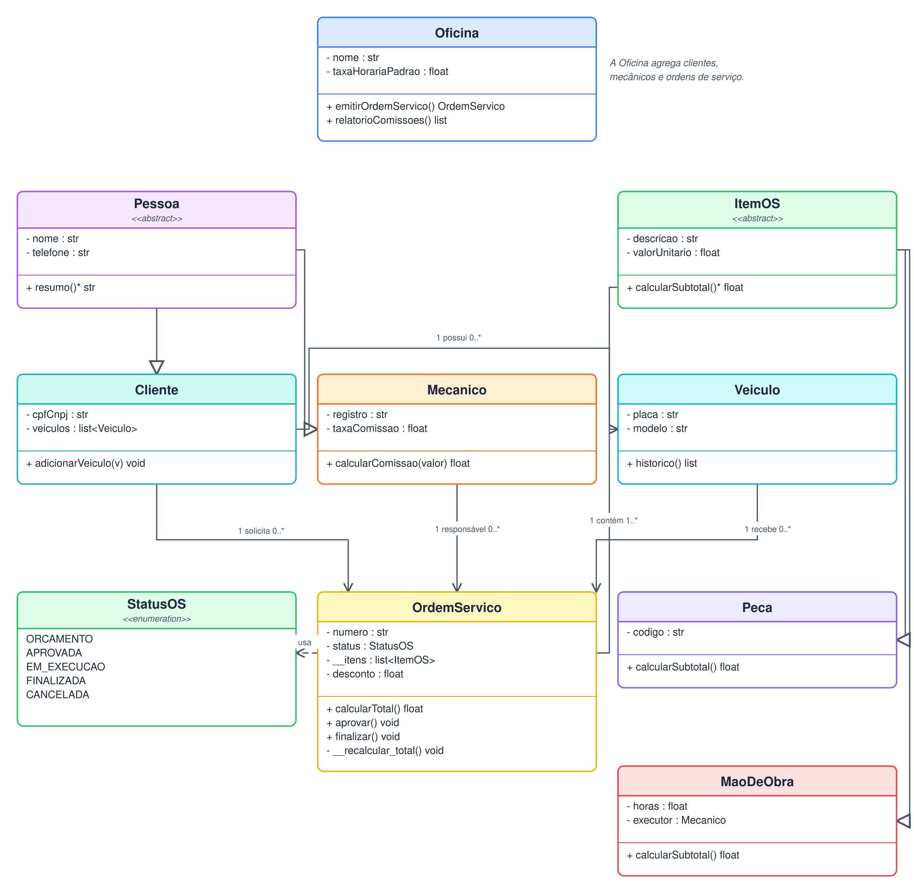
  <figcaption>Figura 1 — Diagrama de classes principal, com herança, associação, composição e os pontos de polimorfismo. A versão detalhada está no Apêndice A.</figcaption>
</figure>

## 4.2 Notação utilizada

| Elemento | Notação | Uso no modelo |
|---|---|---|
| Classe | Retângulo com nome, atributos e métodos | Todas as entidades |
| Classe abstrata | `<<abstract>>` | `Pessoa`, `ItemOS` |
| Enumerador | `<<enumeration>>` | `StatusOS` |
| Atributo privado | `-` antes do nome | `- __itens`, `- cpfCnpj` |
| Método público | `+` antes do nome | `+ calcularTotal()` |
| Método privado | `-` antes do nome | `- __recalcular_total()` |
| Herança | Triângulo vazado apontando para a superclasse | `Cliente` e `Mecanico` herdam de `Pessoa` |
| Associação | Linha com multiplicidade | `Cliente 1 — 0..* Veiculo` |
| Composição | Losango preenchido | `OrdemServico` contém `ItemOS` |
| Dependência | Seta tracejada | `OrdemServico` usa `StatusOS` |

## 4.3 Dicionário de classes

### 4.3.1 Oficina

**Responsabilidade:** representar o estabelecimento, manter os padrões financeiros e emitir ordens de serviço.

| Tipo | Nome | Descrição |
|---|---|---|
| Atributo | `nome` | Nome fantasia da oficina |
| Atributo | `cnpj` | CNPJ usado em documentos |
| Atributo | `telefone` | Contato principal |
| Atributo | `endereco` | Endereço exibido no orçamento |
| Atributo | `taxaHorariaPadrao` | Valor padrão da hora de serviço |
| Atributo | `comissaoPadrao` | Percentual padrão de comissão |
| Método | `adicionarCliente(c)` | Vincula cliente à oficina |
| Método | `adicionarMecanico(m)` | Vincula mecânico à oficina |
| Método | `emitirOrdemServico(c, v)` | Cria uma OS em `ORCAMENTO` |
| Método | `relatorioComissoes(inicio, fim)` | Consolida comissões do período |

### 4.3.2 Pessoa (abstrata)

**Responsabilidade:** padronizar os dados de contato e o contrato de resumo.

| Tipo | Nome | Descrição |
|---|---|---|
| Atributo | `nome` | Nome completo ou razão social |
| Atributo | `telefone` | Telefone com DDD |
| Atributo | `email` | E-mail opcional |
| Método | `resumo()*` | Contrato abstrato de apresentação |
| Método | `__validarContato()` | Validação interna de nome e telefone |

### 4.3.3 Cliente

**Responsabilidade:** identificar o contratante e manter seus veículos.

| Tipo | Nome | Descrição |
|---|---|---|
| Atributo | `cpfCnpj` | Documento único |
| Atributo | `endereco` | Endereço do cliente |
| Atributo | `veiculos` | Lista de veículos vinculados |
| Método | `adicionarVeiculo(v)` | Vincula um veículo |
| Método | `listarVeiculos()` | Retorna os veículos do cliente |
| Método | `resumo()` | Implementa o contrato de `Pessoa` |

### 4.3.4 Mecanico

**Responsabilidade:** identificar o executor e calcular sua comissão.

| Tipo | Nome | Descrição |
|---|---|---|
| Atributo | `registro` | Matrícula interna |
| Atributo | `especialidade` | Área de atuação |
| Atributo | `taxaComissao` | Percentual sobre mão de obra |
| Método | `calcularComissao(valor)` | Aplica a taxa ao valor informado |
| Método | `resumo()` | Implementa o contrato de `Pessoa` |

### 4.3.5 Veiculo

**Responsabilidade:** representar o automóvel atendido e seu histórico.

| Tipo | Nome | Descrição |
|---|---|---|
| Atributo | `placa` | Identificador único do veículo |
| Atributo | `marca` | Fabricante |
| Atributo | `modelo` | Modelo/versão |
| Atributo | `ano` | Ano de fabricação/modelo |
| Atributo | `km` | Quilometragem atual |
| Atributo | `cliente` | Proprietário |
| Método | `atualizarKm(km)` | Atualiza a quilometragem |
| Método | `historico()` | Retorna as OS do veículo |
| Método | `descricao()` | Retorna “marca modelo · placa” |

### 4.3.6 OrdemServico

**Responsabilidade:** agregar o atendimento, controlar o ciclo de vida e calcular totais.

| Tipo | Nome | Descrição |
|---|---|---|
| Atributo | `numero` | Número único no formato `YYYY-NNNN` |
| Atributo | `status` | Estado atual (`StatusOS`) |
| Atributo | `cliente` | Cliente do atendimento |
| Atributo | `veiculo` | Veículo atendido |
| Atributo | `responsavel` | Mecânico responsável |
| Atributo | `__itens` | Coleção privada de `ItemOS` |
| Atributo | `desconto` | Desconto aplicado ao total |
| Atributo | `dataAbertura` | Data/hora de abertura |
| Atributo | `dataFinalizacao` | Data/hora de finalização |
| Atributo | `observacoes` | Anotações do atendimento |
| Método | `adicionarItem(item)` | Adiciona item e recalcula |
| Método | `removerItem(item)` | Remove item e recalcula |
| Método | `calcularSubtotal()` | Soma os subtotais dos itens |
| Método | `calcularTotal()` | Aplica o desconto ao subtotal |
| Método | `aprovar()` | `ORCAMENTO → APROVADA` |
| Método | `iniciar()` | `APROVADA → EM_EXECUCAO` |
| Método | `finalizar()` | `EM_EXECUCAO → FINALIZADA` |
| Método | `cancelar()` | Cancela com motivo |
| Método | `podeTransicionar(novo)` | Consulta a regra de transição |
| Método | `__recalcular_total()` | Recalcula e atualiza o total interno |
| Método | `__validar_transicao(novo)` | Valida a transição antes de aplicar |

### 4.3.7 ItemOS (abstrata)

**Responsabilidade:** definir o contrato comum dos itens cobrados.

| Tipo | Nome | Descrição |
|---|---|---|
| Atributo | `descricao` | Descrição do item |
| Atributo | `quantidade` | Quantidade (peça) ou base de cálculo |
| Atributo | `valorUnitario` | Valor unitário ou taxa |
| Método | `calcularSubtotal()*` | Contrato polimórfico |
| Método | `descrever()*` | Contrato de descrição para o documento |

### 4.3.8 Peca

**Responsabilidade:** representar uma peça aplicada ao veículo.

| Tipo | Nome | Descrição |
|---|---|---|
| Atributo | `codigo` | Código interno/fornecedor |
| Atributo | `fornecedor` | Fornecedor da peça |
| Método | `calcularSubtotal()` | `quantidade × valorUnitario` |
| Método | `descrever()` | Texto para orçamento/recibo |

### 4.3.9 MaoDeObra

**Responsabilidade:** representar o serviço executado por um mecânico.

| Tipo | Nome | Descrição |
|---|---|---|
| Atributo | `horas` | Horas trabalhadas |
| Atributo | `taxaHoraria` | Valor da hora |
| Atributo | `executor` | Mecânico que executou |
| Método | `calcularSubtotal()` | `horas × taxaHoraria` |
| Método | `descrever()` | Texto para orçamento/recibo |

### 4.3.10 StatusOS (enumeração)

| Valor | Significado |
|---|---|
| `ORCAMENTO` | OS aberta, orçamento em elaboração ou aguardando aprovação |
| `APROVADA` | Cliente aprovou; serviço pode iniciar |
| `EM_EXECUCAO` | Serviço em andamento |
| `FINALIZADA` | Serviço concluído; recibo disponível |
| `CANCELADA` | Atendimento encerrado sem execução/conclusão |

## 4.4 Diagrama detalhado

O diagrama detalhado inclui todos os atributos e métodos, inclusive os métodos privados e as multiplicidades. Ele é a referência para a implementação da Etapa 3.

<figure class="figure-85">
  
  <figcaption>Figura 2 — Diagrama de classes detalhado. A versão em tamanho maior está no Apêndice A.</figcaption>
</figure>

## 4.5 Mapa explícito dos requisitos de POO

A tabela abaixo conecta cada exigência da atividade aos elementos do modelo. Ela também serve como checklist de correção.

| Exigência | Onde está no modelo | Como foi atendida | Evidência |
|---|---|---|---|
| Pelo menos 5 classes | Seção 4.3 | 9 classes + 1 enumerador | `Oficina`, `Pessoa`, `Cliente`, `Mecanico`, `Veiculo`, `OrdemServico`, `ItemOS`, `Peca`, `MaoDeObra`, `StatusOS` |
| Herança | Figura 1 e 2 | `Pessoa` é superclasse de `Cliente` e `Mecanico`; `ItemOS` é superclasse de `Peca` e `MaoDeObra` | Setas com triângulo vazado |
| Polimorfismo | `ItemOS.calcularSubtotal()` | `Peca` calcula quantidade × valor; `MaoDeObra` calcula horas × taxa; `OrdemServico` percorre `ItemOS` sem conhecer o tipo concreto | Métodos sobrescritos |
| Associação | Figura 1 e 2 | `Cliente 1 — 0..* Veiculo`; `Cliente 1 — 0..* OrdemServico`; `Veiculo 1 — 0..* OrdemServico`; `OrdemServico 1 — 1..* ItemOS`; `Mecanico 1 — 0..* OrdemServico` | Multiplicidades nas linhas |
| Atributo privado | `OrdemServico.__itens` | A coleção só é acessada por métodos da própria classe; em Python, o nome é mangleado para `_OrdemServico__itens` | `- __itens : list<ItemOS>` |
| Método privado | `OrdemServico.__recalcular_total()` | Recalcula o total após adicionar/remover item ou alterar desconto; não faz parte da API pública | `- __recalcular_total() void` |
| Programa principal com 2+ objetos | Seção 4.7 | Prévia de `main.py` com 2 clientes, 2 veículos e 2 ordens de serviço | Código comentado |
| Composição | `OrdemServico` contém `ItemOS` | Itens não existem sem a OS; o losango fica no lado da OS | Losango preenchido |
| Enumeração | `StatusOS` | Cinco estados válidos, sem strings mágicas | `<<enumeration>>` |

### 4.5.1 Polimorfismo em código

O trecho abaixo é a forma prevista para a Etapa 3. A classe abstrata define o contrato; as subclasses implementam o cálculo; a OS não precisa de `if tipo == "peça"`.

```python
from abc import ABC, abstractmethod
from decimal import Decimal

class ItemOS(ABC):
    def __init__(self, descricao: str, quantidade: Decimal, valor_unitario: Decimal):
        self.descricao = descricao
        self.quantidade = quantidade
        self.valor_unitario = valor_unitario

    @abstractmethod
    def calcular_subtotal(self) -> Decimal:
        ...

class Peca(ItemOS):
    def calcular_subtotal(self) -> Decimal:
        return self.quantidade * self.valor_unitario

class MaoDeObra(ItemOS):
    def __init__(self, descricao: str, horas: Decimal, taxa_horaria: Decimal):
        super().__init__(descricao, horas, taxa_horaria)
        self.horas = horas
        self.taxa_horaria = taxa_horaria

    def calcular_subtotal(self) -> Decimal:
        return self.horas * self.taxa_horaria
```

### 4.5.2 Encapsulamento de `__itens`

```python
class OrdemServico:
    def __init__(self, numero: str):
        self.numero = numero
        self.__itens: list[ItemOS] = []
        self.__total = Decimal("0.00")

    def adicionar_item(self, item: ItemOS) -> None:
        if item.calcular_subtotal() <= 0:
            raise ValueError("O item deve ter subtotal positivo.")
        self.__itens.append(item)
        self.__recalcular_total()

    def remover_item(self, item: ItemOS) -> None:
        self.__itens.remove(item)
        self.__recalcular_total()

    def __recalcular_total(self) -> None:
        subtotal = sum((item.calcular_subtotal() for item in self.__itens), Decimal("0.00"))
        if self.desconto < 0 or self.desconto > subtotal:
            raise ValueError("Desconto inválido.")
        self.__total = subtotal - self.desconto

    @property
    def total(self) -> Decimal:
        return self.__total

    @property
    def itens(self) -> tuple[ItemOS, ...]:
        return tuple(self.__itens)  # cópia somente leitura
```

O atributo `__itens` não é exposto diretamente. A propriedade `itens` devolve uma tupla imutável, preservando o encapsulamento e permitindo que a interface apenas leia os dados. O método `__recalcular_total()` é privado e centraliza a regra financeira, evitando que a UI ou os serviços alterem o total manualmente.

## 4.6 Princípios aplicados

| Princípio | Aplicação |
|---|---|
| **Encapsulamento** | `OrdemServico` mantém `__itens`, `__total` e `__recalcular_total()` privados; a UI usa métodos públicos |
| **Herança** | `Cliente` e `Mecanico` reaproveitam `Pessoa`; `Peca` e `MaoDeObra` reaproveitam `ItemOS` |
| **Polimorfismo** | `calcularSubtotal()` é chamado de forma uniforme pela OS |
| **Composição** | A OS é dona dos itens; o ciclo de vida do item está subordinado ao da OS |
| **Coesão** | Cada classe tem uma responsabilidade clara: cliente, veículo, item, OS, oficina |
| **Baixo acoplamento** | A UI conversa com serviços; serviços conversam com repositórios; o domínio não conhece SQLite |
| **Fail fast** | Validações lançam exceções antes de persistir dados inválidos |
| **Auditabilidade** | Toda transição de status é registrada em `status_historico` |

### 4.6.1 Por que `OrdemServico` é a raiz de agregação

A OS é o ponto de consistência do atendimento. Um item não faz sentido sem uma OS; um total não existe sem itens; um status não pode mudar sem validar a transição. Por isso, as operações de adicionar/remover item e de mudança de estado passam pela OS, e não diretamente pelos itens.

### 4.6.2 Por que `ItemOS` é abstrata

Peça e mão de obra compartilham descrição e a necessidade de calcular subtotal, mas têm fórmulas diferentes. A classe abstrata permite que a OS trate ambos de forma uniforme, enquanto cada subclasse mantém seus próprios atributos (código/fornecedor versus horas/taxa/executor).

### 4.6.3 Por que `StatusOS` é enumeração

Strings livres permitiriam estados inválidos (`"aprovado"`, `"Aprovada"`, `"EM_EXECUÇÃO"`). A enumeração garante um conjunto fechado e serve de base para a máquina de estados.

## 4.7 Prévia do programa principal

O programa abaixo demonstra a criação de múltiplos objetos (dois clientes, dois veículos e duas OS), o uso do polimorfismo e o cálculo de comissão. Ele é uma **prévia conceitual**: a implementação completa, com persistência e interface, será entregue na Etapa 3.

```python
from decimal import Decimal
from domain.oficina import Oficina
from domain.cliente import Cliente
from domain.mecanico import Mecanico
from domain.veiculo import Veiculo
from domain.peca import Peca
from domain.mao_de_obra import MaoDeObra


def main() -> None:
    oficina = Oficina(
        nome="DevSolo Studio",
        cnpj="12.345.678/0001-90",
        taxa_horaria_padrao=Decimal("120.00"),
    )

    mecanico = Mecanico(
        nome="Marcos Silva",
        telefone="(11) 98888-0001",
        registro="MEC-001",
        taxa_comissao=Decimal("0.12"),
    )

    ana = Cliente("Ana Paula Ribeiro", "(11) 98765-4321", "123.456.789-00")
    carlos = Cliente("Carlos Eduardo Lima", "(11) 97654-3210", "234.567.890-11")

    civic = Veiculo("ABC-1D23", "Honda", "Civic", 2019, 62480, ana)
    gol = Veiculo("XYZ-9K87", "Volkswagen", "Gol", 2015, 118920, carlos)

    os1 = oficina.emitir_ordem_servico(ana, civic, mecanico)
    os1.adicionar_item(Peca("Filtro de óleo", 1, Decimal("45.00"), "FO-1842", "AutoPeças Central"))
    os1.adicionar_item(Peca("Óleo 5W30", 1, Decimal("180.00"), "OL-5W30", "Lubrax"))
    os1.adicionar_item(MaoDeObra("Troca de óleo e filtros", Decimal("1.5"), Decimal("120.00"), mecanico))
    os1.adicionar_item(MaoDeObra("Alinhamento e balanceamento", Decimal("1.0"), Decimal("120.00"), mecanico))

    os2 = oficina.emitir_ordem_servico(carlos, gol, mecanico)
    os2.adicionar_item(Peca("Pastilha de freio", 1, Decimal("320.00"), "PF-2210", "Bosch"))
    os2.adicionar_item(MaoDeObra("Substituição de pastilhas", Decimal("1.5"), Decimal("120.00"), mecanico))

    print(os1.resumo())
    print(os2.resumo())
    print(f"Comissão prevista: R$ {mecanico.calcular_comissao(os1.subtotal_mao_obra):.2f}")


if __name__ == "__main__":
    main()
```

**Saída esperada (resumo):**

```text
OS 2026-0001 • Ana Paula Ribeiro • Honda Civic ABC-1D23
Itens: 4 • Subtotal: R$ 525,00 • Total: R$ 525,00 • Status: ORCAMENTO

OS 2026-0002 • Carlos Eduardo Lima • Volkswagen Gol XYZ-9K87
Itens: 2 • Subtotal: R$ 500,00 • Total: R$ 500,00 • Status: ORCAMENTO

Comissão prevista: R$ 30,00
```

> **Observação:** os valores acima são apenas ilustrativos para demonstrar a criação dos objetos e a chamada polimórfica. O cálculo real da OS 2026-0042 usado nos wireframes é R$ 1.240,00 (Seção 3.4).

## 4.8 Evolução prevista do modelo

Para a Etapa 3, o modelo pode evoluir sem quebrar a estrutura atual:

- **Repositórios:** `ClienteRepository`, `VeiculoRepository`, `OrdemServicoRepository`, com interface comum.
- **Serviços:** `OrdemServicoService`, `RelatorioService`, `OrcamentoService`, `ConfiguracaoService`.
- **Objetos de valor:** `Dinheiro`, `Placa`, `Documento`, `Periodo`, para validações mais fortes.
- **Eventos de domínio:** `OrdemAprovada`, `OrdemFinalizada`, para disparar PDF, histórico e relatórios.
- **Testes:** unitários de domínio, integração com SQLite em memória e testes de contrato dos serviços.


# 5. Diagrama de estados da OS

## 5.1 Visão geral

A ordem de serviço tem um ciclo de vida explícito. O diagrama abaixo mostra os cinco estados e as transições permitidas. A regra é implementada por `OrdemServico.__validar_transicao()` e registrada em `status_historico`.

<figure>
  
  <figcaption>Figura 3 — Máquina de estados da OS: ORCAMENTO, APROVADA, EM_EXECUCAO, FINALIZADA e CANCELADA.</figcaption>
</figure>

## 5.2 Descrição dos estados

| Estado | Significado | O que pode acontecer | Próximos estados |
|---|---|---|---|
| `ORCAMENTO` | OS aberta; itens sendo montados ou orçamento aguardando o cliente | Editar itens, aplicar desconto, gerar PDF, enviar WhatsApp, aprovar, cancelar | `APROVADA`, `CANCELADA` |
| `APROVADA` | Cliente autorizou o serviço | Iniciar execução, cancelar com motivo | `EM_EXECUCAO`, `CANCELADA` |
| `EM_EXECUCAO` | Serviço em andamento | Finalizar, cancelar com motivo | `FINALIZADA`, `CANCELADA` |
| `FINALIZADA` | Serviço concluído e recibo disponível | Consultar recibo, imprimir, calcular comissão | Nenhum (estado terminal) |
| `CANCELADA` | Atendimento encerrado sem conclusão | Consultar histórico | Nenhum (estado terminal) |

## 5.3 Tabela de transições

| De | Evento | Guarda | Para | Efeitos colaterais |
|---|---|---|---|---|
| `ORCAMENTO` | `aprovar()` | Orçamento válido, pelo menos 1 item, total > 0 | `APROVADA` | Grava `data_aprovacao`, usuário e histórico |
| `APROVADA` | `iniciar()` | Mecânico responsável definido | `EM_EXECUCAO` | Grava `data_inicio` e histórico |
| `EM_EXECUCAO` | `finalizar()` | Pelo menos 1 item, valores consistentes | `FINALIZADA` | Grava `data_finalizacao`, gera recibo e comissão |
| `ORCAMENTO` | `cancelar(motivo)` | Motivo informado | `CANCELADA` | Grava `data_cancelamento`, motivo e histórico |
| `APROVADA` | `cancelar(motivo)` | Motivo informado | `CANCELADA` | Grava `data_cancelamento`, motivo e histórico |
| `EM_EXECUCAO` | `cancelar(motivo)` | Motivo informado | `CANCELADA` | Grava `data_cancelamento`, motivo e histórico |
| `FINALIZADA` | `cancelar()` | — | Bloqueado | Lança `TransicaoInvalida` |
| `CANCELADA` | Qualquer evento | — | Bloqueado | Lança `TransicaoInvalida` |

## 5.4 Invariantes

1. Uma OS sempre tem exatamente um status válido.
2. `data_finalizacao` só existe em `FINALIZADA`.
3. `data_cancelamento` só existe em `CANCELADA`.
4. Uma OS `FINALIZADA` não pode voltar a `EM_EXECUCAO`; retrabalho deve gerar nova OS ou ordem de garantia.
5. Uma OS `CANCELADA` não pode ser reaberta; deve ser criada uma nova OS.
6. O histórico de status é append-only: cada transição gera uma linha, sem atualização destrutiva.
7. A comissão só é considerada para OS `FINALIZADA`.

## 5.5 Exemplo de caminho válido

```text
ORCAMENTO --aprovar()--> APROVADA --iniciar()--> EM_EXECUCAO --finalizar()--> FINALIZADA
```

Com cancelamento:

```text
ORCAMENTO --cancelar("Cliente desistiu")--> CANCELADA
APROVADA  --cancelar("Peça indisponível")--> CANCELADA
EM_EXECUCAO --cancelar("Cliente solicitou interrupção")--> CANCELADA
```

## 5.6 Exemplo de transição inválida

```text
FINALIZADA --cancelar()--> ERRO: "OS finalizada não pode ser cancelada."
CANCELADA  --aprovar()--> ERRO: "OS cancelada não pode ser aprovada."
ORCAMENTO  --finalizar()--> ERRO: "A OS precisa estar em execução para ser finalizada."
```

A mensagem deve ser exibida na interface em linguagem clara, sem termos técnicos, e o botão inválido deve ficar desabilitado quando possível. A validação de domínio continua sendo a última linha de defesa.


# 6. Arquitetura e persistência

## 6.1 Visão em camadas

A aplicação segue uma separação em quatro camadas. A interface não acessa SQLite diretamente; os serviços coordenam o domínio e os repositórios; o domínio concentra as regras.

<figure>
  
  <figcaption>Figura 4 — Arquitetura lógica: apresentação, aplicação, domínio e infraestrutura.</figcaption>
</figure>

| Camada | Responsabilidade | Componentes previstos |
|---|---|---|
| Apresentação | Renderizar telas, capturar eventos, validar formulários e exibir feedback | `App`, `DashboardView`, `ClienteView`, `VeiculoView`, `OrdemServicoView`, `RelatorioView`, `ConfiguracaoView` |
| Aplicação | Orquestrar casos de uso, transações e autorização simples | `OrdemServicoService`, `RelatorioService`, `OrcamentoService`, `ConfiguracaoService` |
| Domínio | Entidades, regras de negócio, cálculos e transições | `Oficina`, `Pessoa`, `Cliente`, `Mecanico`, `Veiculo`, `OrdemServico`, `ItemOS`, `Peca`, `MaoDeObra`, `StatusOS` |
| Infraestrutura | Persistência, PDF, backup, configuração e logs | Repositórios SQLite, `Database`, `PdfGenerator`, `BackupService`, `Settings` |

## 6.2 Estrutura de pastas prevista

```text
oficinapro/
├── main.py
├── domain/
│   ├── pessoa.py
│   ├── cliente.py
│   ├── mecanico.py
│   ├── veiculo.py
│   ├── item_os.py
│   ├── peca.py
│   ├── mao_de_obra.py
│   ├── ordem_servico.py
│   ├── status_os.py
│   └── oficina.py
├── application/
│   ├── ordem_servico_service.py
│   ├── relatorio_service.py
│   ├── orcamento_service.py
│   └── configuracao_service.py
├── infrastructure/
│   ├── database.py
│   ├── repositories/
│   ├── pdf/
│   ├── backup.py
│   └── settings.py
├── ui/
│   ├── app.py
│   ├── telas/
│   └── componentes/
└── tests/
    ├── test_dominio.py
    ├── test_ordem_servico.py
    ├── test_comissoes.py
    └── test_repositorios.py
```

## 6.3 Modelo de dados SQLite

O esquema usa **single-table inheritance** para os itens: uma única tabela `item_os` guarda peças e mão de obra, diferenciadas pela coluna `tipo`. Essa escolha simplifica consultas de relatório e mantém a integridade referencial com a OS. As subclasses `Peca` e `MaoDeObra` continuam existindo no domínio.

| Tabela | Campos principais | Chaves e restrições |
|---|---|---|
| `oficina` | `id`, `nome`, `cnpj`, `telefone`, `endereco`, `taxa_horaria_padrao`, `comissao_padrao`, `criado_em` | `id` PK; `cnpj` UNIQUE; `taxa_horaria_padrao >= 0`; `comissao_padrao BETWEEN 0 AND 1` |
| `cliente` | `id`, `nome`, `telefone`, `email`, `cpf_cnpj`, `endereco`, `data_nascimento`, `observacoes`, `ativo`, `criado_em` | `id` PK; `cpf_cnpj` UNIQUE; `ativo` default 1; índice em `nome` |
| `mecanico` | `id`, `nome`, `telefone`, `email`, `registro`, `especialidade`, `taxa_comissao`, `ativo` | `id` PK; `registro` UNIQUE; `taxa_comissao BETWEEN 0 AND 1` |
| `veiculo` | `id`, `cliente_id`, `placa`, `marca`, `modelo`, `ano`, `km`, `cor`, `combustivel`, `observacoes` | `id` PK; `cliente_id` FK → `cliente`; `placa` UNIQUE; `ano` e `km >= 0` |
| `ordem_servico` | `id`, `numero`, `cliente_id`, `veiculo_id`, `mecanico_id`, `status`, `desconto`, `data_abertura`, `data_aprovacao`, `data_inicio`, `data_finalizacao`, `data_cancelamento`, `motivo_cancelamento`, `observacoes`, `criado_por` | `id` PK; `numero` UNIQUE; FKs; `status` CHECK; `desconto >= 0`; índices em `status` e `data_abertura` |
| `item_os` | `id`, `ordem_servico_id`, `tipo`, `descricao`, `quantidade`, `valor_unitario`, `horas`, `taxa_horaria`, `mecanico_id`, `codigo_peca`, `fornecedor` | `id` PK; `ordem_servico_id` FK; `tipo` CHECK (`PECA`, `MAO_DE_OBRA`); `mecanico_id` FK; `quantidade/horas/valor >= 0` |
| `status_historico` | `id`, `ordem_servico_id`, `status_anterior`, `status_novo`, `data_hora`, `usuario`, `motivo` | `id` PK; `ordem_servico_id` FK; `status_anterior`/`status_novo` CHECK; append-only |
| `configuracao` | `chave`, `valor`, `atualizado_em` | `chave` PK; valores serializados em texto |
| `comissao_pagamento` | `id`, `mecanico_id`, `periodo_inicio`, `periodo_fim`, `valor`, `pago_em`, `observacoes` | `id` PK; `mecanico_id` FK; `valor >= 0`; opcional para Etapa 3 |

### 6.3.1 Relacionamentos

| Relação | Cardinalidade | Regra |
|---|---|---|
| `oficina` → `cliente` | 1 : N | Uma oficina atende vários clientes |
| `oficina` → `mecanico` | 1 : N | Uma oficina emprega vários mecânicos |
| `cliente` → `veiculo` | 1 : N | Um cliente pode ter vários veículos |
| `cliente` → `ordem_servico` | 1 : N | Um cliente pode solicitar várias OS |
| `veiculo` → `ordem_servico` | 1 : N | Um veículo pode receber várias OS |
| `mecanico` → `ordem_servico` | 1 : N | Um mecânico pode ser responsável por várias OS |
| `ordem_servico` → `item_os` | 1 : N | Uma OS contém um ou mais itens (composição) |
| `mecanico` → `item_os` | 1 : N | Um mecânico pode executar vários itens de mão de obra |
| `ordem_servico` → `status_historico` | 1 : N | Uma OS tem vários registros de transição |

### 6.3.2 Índices e desempenho

```sql
CREATE INDEX idx_cliente_nome       ON cliente(nome);
CREATE INDEX idx_cliente_cpf        ON cliente(cpf_cnpj);
CREATE INDEX idx_veiculo_placa      ON veiculo(placa);
CREATE INDEX idx_os_status          ON ordem_servico(status);
CREATE INDEX idx_os_data_abertura   ON ordem_servico(data_abertura);
CREATE INDEX idx_item_os_os         ON item_os(ordem_servico_id);
CREATE INDEX idx_item_os_mecanico   ON item_os(mecanico_id);
```

As consultas de relatório filtram por `data_finalizacao` e `mecanico_id`. Para volumes maiores, pode-se criar um índice composto:

```sql
CREATE INDEX idx_os_finalizada_mecanico
  ON ordem_servico(mecanico_id, data_finalizacao)
  WHERE status = 'FINALIZADA';
```

### 6.3.3 Integridade e transações

- `PRAGMA foreign_keys = ON;` em toda conexão.
- `PRAGMA journal_mode = WAL;` para melhor concorrência de leitura.
- `PRAGMA busy_timeout = 5000;` para evitar falhas momentâneas.
- Operações que envolvem OS + itens usam uma única transação.
- Aprovação, finalização e cancelamento usam transação com `UPDATE` condicional no status atual para evitar dupla transição.
- Exclusão de cliente é lógica (`ativo = 0`), preservando o histórico.
- Valores monetários são convertidos para centavos ou `Decimal` na aplicação; o SQLite armazena `NUMERIC`/`TEXT` conforme a estratégia adotada.

### 6.3.4 Backup e restauração

O backup pode ser feito com `VACUUM INTO` para gerar uma cópia consistente:

```sql
VACUUM INTO 'backups/oficinapro_2026-10-26.db';
```

Regras:

1. Fazer backup antes de qualquer migração de schema.
2. Manter os últimos 7 backups automáticos e permitir backup manual.
3. Restaurar somente com confirmação explícita e com o aplicativo fechado.
4. Validar a integridade do arquivo restaurado com `PRAGMA integrity_check;`.
5. Nunca armazenar o backup apenas no mesmo diretório do banco principal.

### 6.3.5 Migrações

O controle de versão do schema pode usar `PRAGMA user_version` ou uma tabela `schema_migrations`. Cada migração deve ser idempotente e testada com um banco de exemplo. A Etapa 3 deve começar com a versão `1` e evoluir por scripts numerados.

## 6.4 Decisões de persistência

| Decisão | Alternativa descartada | Motivo |
|---|---|---|
| SQLite local | PostgreSQL/MySQL | Simplicidade de instalação em desktop e backup por arquivo |
| Single-table inheritance em `item_os` | Tabelas separadas `peca` e `mao_de_obra` | Consultas de relatório mais simples; o domínio mantém o polimorfismo |
| Soft delete de cliente | `DELETE` físico | Preserva histórico de OS e auditoria |
| `status_historico` append-only | Apenas o campo `status` na OS | Rastreabilidade e diagnóstico de transições |
| `VACUUM INTO` para backup | Cópia direta do arquivo | Evita cópia inconsistente com WAL ativo |
| `Decimal` na aplicação | `float` puro | Evita erros de arredondamento em dinheiro |


# 7. Design system e identidade visual

## 7.1 Conceito

A identidade da DevSolo Studio combina uma **prancheta** (padronização, checklist, ordem) com uma **chave** (ofício mecânico, solução). O produto OficinaPro usa essa base com uma interface sóbria, de balcão, em que o laranja sinaliza ação e o verde sinaliza aprovação/conclusão. O grafite dá peso e legibilidade; o slate organiza fundos e bordas.

## 7.2 Paleta

| Token | Hex | Uso principal | Contraste |
|---|---|---|---|
| `--graphite` | `#1E293B` | Sidebar, títulos, texto forte | Alto sobre branco |
| `--graphite-900` | `#0F172A` | Fundos escuros, sombras | Alto |
| `--orange` | `#F97316` | Ações primárias, destaque, marca | Usar texto branco |
| `--orange-600` | `#EA580C` | Hover de ações primárias | Usar texto branco |
| `--green` | `#22C55E` | Aprovação, pagamento, sucesso | Usar texto escuro |
| `--green-700` | `#15803D` | Texto de sucesso | Alto sobre branco |
| `--red` | `#EF4444` | Cancelamento, erro | Usar texto branco/escuro conforme fundo |
| `--amber` | `#F59E0B` | Pendência, orçamento | Usar texto escuro |
| `--slate-50` | `#F8FAFC` | Fundo de tabelas/cabeçalhos | Baixo |
| `--slate-100` | `#F1F5F9` | Fundo geral | Baixo |
| `--slate-200` | `#E2E8F0` | Bordas e divisores | Baixo |
| `--slate-500` | `#64748B` | Texto secundário | Médio |
| `--white` | `#FFFFFF` | Cards, documentos | — |

**Regra de uso:** o laranja é reservado para a ação principal de cada tela. Nunca usar laranja em dois botões concorrentes na mesma área. O verde não substitui texto: sempre acompanha rótulo (“Aprovada”, “Pago”) para não depender apenas de cor.

## 7.3 Tipografia

| Elemento | Tamanho | Peso | Uso |
|---|---|---|---|
| Título de página | 22 px | 700 | Cabeçalho de conteúdo |
| Título de seção | 20 px | 700 | Topbar |
| Título de card | 14,5 px | 700 | Cabeçalhos de cards |
| Corpo | 14 px | 400 | Texto geral |
| Texto secundário | 12–13 px | 400/600 | Descrições, metadados |
| Rótulo de tabela | 10,5 px | 700 | Cabeçalhos em caixa alta |
| Badge | 11 px | 700 | Status |
| Número de indicador | 26 px | 700 | Cards de dashboard |

Fonte principal: **Segoe UI** (Windows) com fallback para **Inter**, **Liberation Sans** e **Arial**. Em Linux, a fallback garante renderização consistente. Números monetários usam tabular figures quando disponível.

## 7.4 Espaçamento, raio e sombra

| Token | Valor | Uso |
|---|---|---|
| `space-1` | 4 px | Ajustes finos |
| `space-2` | 8 px | Gap entre ícone e texto |
| `space-3` | 12 px | Gap entre botões |
| `space-4` | 16 px | Gap entre cards |
| `space-5` | 24 px | Padding de drawer |
| `space-6` | 32 px | Padding de conteúdo |
| `radius-sm` | 6 px | Badges e botões pequenos |
| `radius-md` | 9–10 px | Botões, inputs, navegação |
| `radius-lg` | 12 px | Cards e drawers |
| `shadow-card` | `0 1px 2px rgba(15,23,42,.06), 0 8px 24px rgba(15,23,42,.06)` | Cards |

## 7.5 Componentes

| Componente | Especificação | Onde aparece |
|---|---|---|
| Sidebar | 248 px, grafite, item ativo laranja, ícones de 18 px | Todas as telas |
| Topbar | 72 px, branco, título + subtítulo + busca + ação primária | Todas as telas |
| Card | Branco, borda slate-200, raio 12 px, sombra suave | Dashboard, listas, formulários |
| Botão primário | Laranja, texto branco, raio 8 px, altura ~36 px | “Nova OS”, “Salvar”, “Gerar orçamento” |
| Botão secundário | Branco, borda slate-300, texto grafite | “Exportar”, “Cancelar”, “Voltar” |
| Badge de status | Pílula com ponto + texto, cores semânticas | Tabelas e timelines |
| Tabela | Cabeçalho slate-50, linhas com hover creme, ações à direita | Clientes, veículos, OS, relatórios |
| Drawer | 430 px, overlay escuro, fecha com ESC/clique fora | Novo cliente, histórico do veículo |
| Timeline | Círculos concluídos/atuais/pendentes, linha vertical | Status da OS, histórico do veículo |
| Gráfico de barras | Barras laranja/verde/slate, rótulo de valor | Dashboard, relatórios |
| Donut | Composição de faturamento | Relatórios |
| Toast | Fundo grafite, canto inferior direito, 2,4 s | Simulações do protótipo |

## 7.6 Layout e grid

- Alvo desktop: **1440 × 900 px**.
- Sidebar fixa de 248 px; conteúdo fluido.
- Topbar fixa de 72 px; conteúdo com scroll interno.
- Grid de 4 colunas para indicadores; 2 colunas para gráficos e resumos.
- Breakpoint de 1100 px: indicadores em 2 colunas e grids principais em 1 coluna.
- Em telas menores que 900 px, a sidebar pode ser recolhida e o conteúdo passa a ocupar a largura total.
- A aplicação final em CustomTkinter deve respeitar uma janela mínima de **1200 × 800 px**.

## 7.7 Estados de interface

| Estado | Comportamento visual | Exemplo |
|---|---|---|
| Hover | Fundo levemente mais escuro/claro, cursor pointer | Botões e linhas de tabela |
| Focus | Anel laranja de 3 px com transparência | Inputs e botões |
| Disabled | Opacidade 50%, cursor not-allowed | “Finalizar” antes de iniciar |
| Loading | Skeleton ou spinner discreto | Listas e relatórios |
| Empty | Ícone, título e ação sugerida | “Nenhum cliente encontrado” |
| Error | Faixa vermelha com mensagem clara e ação | “CPF já cadastrado” |
| Success | Toast verde ou badge | “Cliente salvo com sucesso” |
| Warning | Faixa âmbar | “Orçamento expira em 2 dias” |

## 7.8 Acessibilidade

- Contraste mínimo de 4,5:1 para texto normal e 3:1 para texto grande.
- Status nunca apenas por cor: usar texto + ponto + posição.
- Todos os inputs com `<label>` associado e mensagens de erro próximas.
- Navegação por teclado: Tab, Shift+Tab, Enter, Esc e setas no protótipo.
- Foco visível em todos os elementos interativos.
- Ícones decorativos com `aria-hidden`; ícones de ação com rótulo acessível.
- Textos alternativos nas imagens e nos gráficos.
- Evitar animações intensas; transições de até 200 ms.

## 7.9 Uso da marca

- O logo horizontal é usado na capa e em documentos; o símbolo quadrado é usado na sidebar.
- Área de respiro mínima: altura do símbolo.
- Tamanho mínimo do símbolo: 32 px.
- Não distorcer, não trocar as cores, não aplicar sombra no logo, não usar sobre fundo de baixo contraste.
- O nome do produto é **OficinaPro** (sem espaço, “P” maiúsculo); a equipe é **DevSolo Studio**.


# 8. Mapa de navegação

## 8.1 Fluxo principal

```text
Dashboard
   │
   ├── Clientes ──► Veículos ──► Ordens de Serviço ──► Editor de OS ──► Orçamento / Recibo
   │                                                                        │
   │                                                                        ├── Aprovar
   │                                                                        ├── Iniciar
   │                                                                        ├── Finalizar
   │                                                                        └── Cancelar
   │
   ├── Relatórios ──► Comissões por mecânico ──► Exportar PDF/CSV
   │
   └── Configurações ──► Dados da oficina • Financeiro • Aparência • Backup • Sobre
```

O fluxo principal foi desenhado para reduzir cliques: a partir do dashboard, o atendente pode abrir uma nova OS em um clique; a lista de OS permite abrir o editor, gerar PDF ou enviar WhatsApp sem sair da tela. Configurações e relatórios ficam disponíveis na sidebar, mas não interrompem o fluxo operacional.

## 8.2 Telas

| ID | Tela | Objetivo | Entrada | Ações principais | Saídas |
|---|---|---|---|---|---|
| T01 | Dashboard | Visão geral do dia e pendências | Login / sidebar | Nova OS, ver OS, abrir relatórios | T04, T05, T07 |
| T02 | Clientes | Cadastrar e consultar clientes | Sidebar / dashboard | Novo cliente, buscar, editar, abrir drawer | T03, T04 |
| T03 | Veículos | Consultar frota e histórico | Sidebar / cliente | Novo veículo, buscar por placa, histórico | T05 |
| T04 | Ordens de Serviço | Acompanhar a fila por status | Sidebar / dashboard | Filtrar, abrir, PDF, WhatsApp | T05, T06 |
| T05 | Editor de OS | Montar a OS e calcular totais | T04 / T03 / dashboard | Adicionar item, salvar, gerar orçamento | T06 |
| T06 | Orçamento / Recibo | Emitir documento e acompanhar status | T05 / T04 | PDF, WhatsApp, imprimir, aprovar, cancelar | T04, T06 |
| T07 | Relatórios | Analisar faturamento e comissões | Sidebar / dashboard | Filtrar período/mecânico, exportar | T06, T04 |
| T08 | Configurações | Ajustar dados e preferências | Sidebar | Salvar, backup, restaurar, alterar tema | T01 |

## 8.3 Regras de navegação

1. A sidebar é persistente em todas as telas; o item ativo usa fundo laranja.
2. O dashboard é a tela inicial; o botão “Nova OS” está sempre visível na topbar.
3. A lista de OS mantém o filtro selecionado ao voltar do editor.
4. O editor de OS abre com cliente e veículo pré-selecionados quando vier de T02/T03.
5. O orçamento abre em uma prévia A4; as ações de PDF/WhatsApp ficam no topo e no painel lateral.
6. O drawer de cliente/veículo fecha com `Esc`, clique no overlay ou botão “Cancelar”.
7. Alterações não salvas no editor disparam confirmação antes de sair.
8. Relatórios e configurações não bloqueiam o fluxo; o usuário pode voltar com um clique.
9. A navegação do protótipo usa as setas `←` e `→` para percorrer as oito telas.
10. Mensagens de erro ficam próximas ao campo ou no topo do formulário, nunca em modal genérico.

## 8.4 Atalhos previstos

| Atalho | Ação | Contexto |
|---|---|---|
| `Ctrl + N` | Nova OS | Global |
| `Ctrl + S` | Salvar | Editor/Configurações |
| `Ctrl + F` | Focar busca | Listas |
| `Ctrl + P` | Imprimir / PDF | Orçamento |
| `Esc` | Fechar drawer/modal | Global |
| `←` / `→` | Tela anterior/próxima | Protótipo |
| `Enter` | Confirmar formulário | Formulários |

## 8.5 Estados vazios e erros de navegação

| Situação | Mensagem | Ação sugerida |
|---|---|---|
| Nenhum cliente encontrado | “Nenhum cliente encontrado com esses filtros.” | Limpar filtros / novo cliente |
| Cliente sem veículo | “Este cliente ainda não tem veículo cadastrado.” | Cadastrar veículo |
| OS sem itens | “Adicione pelo menos uma peça ou serviço para gerar o orçamento.” | Adicionar item |
| Orçamento expirado | “Este orçamento expirou em 02/11/2026. Gere uma nova versão.” | Revalidar |
| Transição inválida | “Não é possível finalizar uma OS que ainda não foi iniciada.” | Iniciar execução |
| Backup inválido | “O arquivo selecionado não é um backup válido do OficinaPro.” | Escolher outro arquivo |
| Erro de conexão | “Não foi possível abrir o banco de dados local.” | Verificar permissões / restaurar backup |


# 9. Wireframes

## 9.1 Visão geral

Os oito wireframes cobrem o fluxo principal do OficinaPro. Eles foram desenhados para **1440 × 900 px**, resolução típica de monitores de balcão, e implementados em HTML/CSS/JS para permitir navegação real e captura em alta resolução. A versão final em CustomTkinter deve reproduzir a mesma hierarquia, os mesmos tokens de cor e os mesmos estados.

| Tela | Nome | Pergunta que responde | Ação principal |
|---|---|---|---|
| T01 | Dashboard | “Como está a oficina hoje?” | Abrir nova OS |
| T02 | Clientes | “Quem são meus clientes e como contatá-los?” | Cadastrar/editar cliente |
| T03 | Veículos | “Qual o histórico deste carro?” | Abrir histórico / nova OS |
| T04 | Ordens de Serviço | “O que está em orçamento, execução e entrega?” | Abrir OS |
| T05 | Editor de OS | “O que será cobrado e quanto custa?” | Gerar orçamento |
| T06 | Orçamento / Recibo | “O cliente pode aprovar e pagar?” | PDF / WhatsApp |
| T07 | Relatórios | “Quanto faturei e quanto devo de comissão?” | Exportar relatório |
| T08 | Configurações | “Como a oficina e o sistema estão configurados?” | Salvar preferências |

## 9.2 T01 — Dashboard

<figure class="figure-90">
  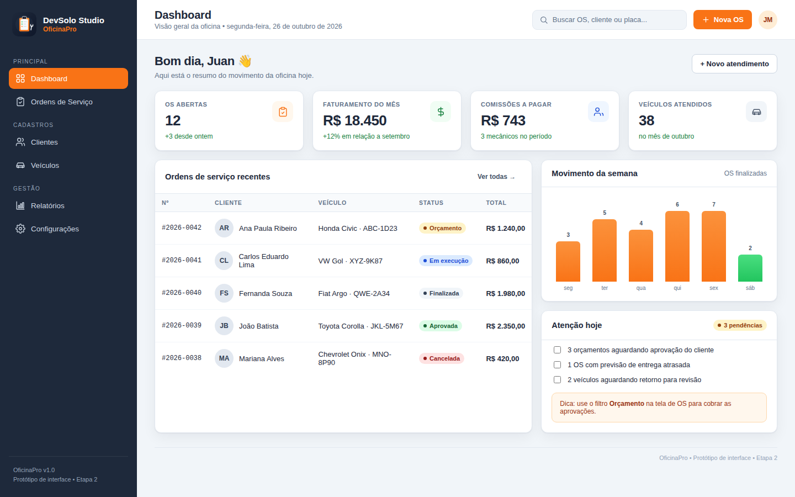
  <figcaption>Figura 5 — Dashboard: indicadores, ordens recentes, movimento semanal e pendências do dia.</figcaption>
</figure>

**Objetivo:** dar ao gestor uma leitura rápida do dia, com indicadores financeiros e operacionais, sem exigir navegação.

**Componentes:** quatro cards de indicadores (OS abertas, faturamento do mês, comissões a pagar, veículos atendidos); tabela de ordens recentes com status e total; gráfico de barras de OS finalizadas na semana; card “Atenção hoje” com pendências; busca global; botão “Nova OS”; avatar do usuário.

**Interações:** “Nova OS” abre o editor (T05); “Ver todas” leva à lista de OS (T04); as linhas da tabela podem abrir a OS correspondente; o card de atenção sugere filtrar por “Orçamento” em T04; o checkbox de pendência é apenas visual no protótipo.

**Dados:** 12 OS abertas, faturamento de R$ 18.450,00, comissões de R$ 743,00 e 38 veículos atendidos no mês. A tabela mostra as cinco OS mais recentes; o gráfico usa a semana corrente.

**Estados:** com o banco vazio, os cards mostram “0” e a tabela exibe um estado vazio com CTA “Abrir primeira OS”; se o carregamento falhar, um banner vermelho aparece no topo com “Tentar novamente”.

**Critérios de aceite:** todos os números são derivados do banco, não fixos; a ação “Nova OS” está a um clique; a tabela não quebra em 1440 px; o status é legível sem depender apenas de cor.

## 9.3 T02 — Clientes

<figure>
  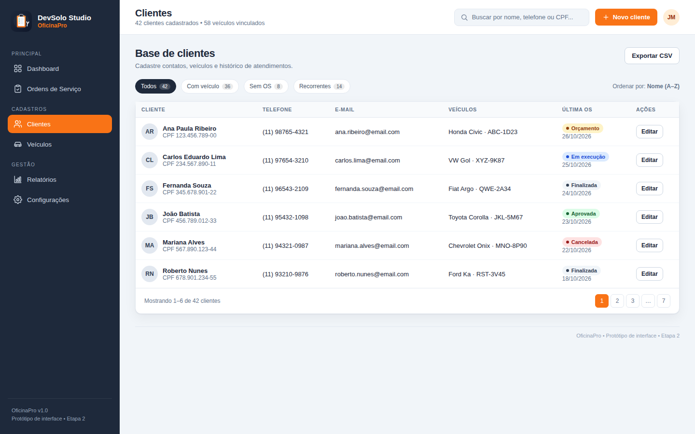
  <figcaption>Figura 6 — Clientes: busca, filtros, tabela de contatos e ações de edição.</figcaption>
</figure>

**Objetivo:** permitir que o atendente encontre um cliente rapidamente e acesse seus veículos e histórico.

**Componentes:** busca por nome, telefone ou CPF; filtros “Todos”, “Com veículo”, “Sem OS” e “Recorrentes”; tabela com cliente, telefone, e-mail, veículo, última OS e ação “Editar”; paginação; botão “Novo cliente”; exportação CSV.

**Interações:** “Novo cliente” abre o drawer de cadastro (Figura 17); “Editar” abre o mesmo drawer preenchido; clicar no nome pode abrir o detalhe do cliente; o filtro “Com veículo” remove clientes sem veículo; a busca é incremental e ignora acentos.

**Dados:** 42 clientes, 58 veículos vinculados; a tabela mostra 6 registros por página. O CPF é exibido de forma parcial em contextos de lista, quando a política de privacidade exigir.

**Estados:** “Nenhum cliente encontrado” com ação “Limpar filtros”; erro de CPF duplicado no drawer; loading com skeleton nas linhas; confirmação antes de inativar cliente com OS.

**Critérios de aceite:** buscar por placa também encontra o cliente; o drawer valida nome, telefone e CPF/CNPJ; o cadastro salva e atualiza a lista sem recarregar a página.

## 9.4 T03 — Veículos

<figure>
  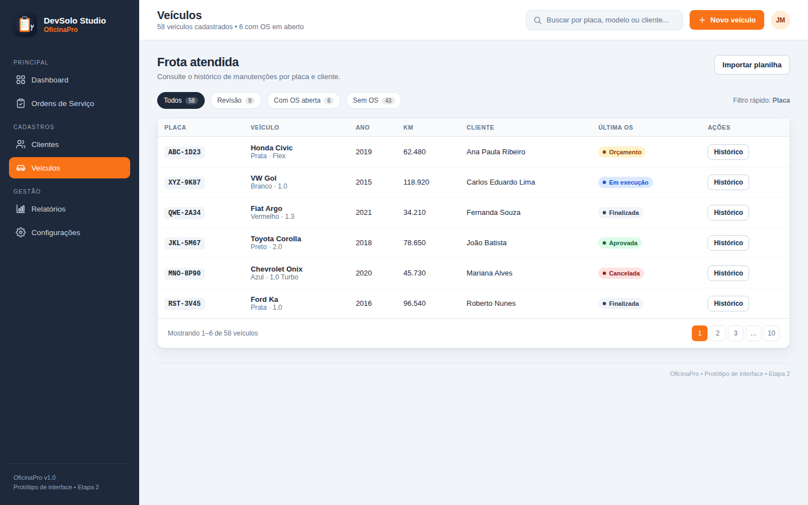
  <figcaption>Figura 7 — Veículos: frota atendida, filtros por situação e acesso ao histórico.</figcaption>
</figure>

**Objetivo:** consultar a frota por placa, modelo ou cliente e abrir o histórico de manutenções.

**Componentes:** busca por placa/modelo/cliente; filtros “Todos”, “Revisão”, “Com OS aberta” e “Sem OS”; tabela com placa, veículo, ano, KM, cliente, última OS e ação “Histórico”; botão “Novo veículo”; importação de planilha.

**Interações:** “Histórico” abre o drawer com dados do veículo e timeline de OS (Figura 18); “Abrir nova OS” no drawer leva ao editor com o veículo pré-selecionado; a placa é validada no cadastro; a busca aceita placa com ou sem hífen.

**Dados:** 58 veículos, 6 com OS aberta; a tabela mostra 6 registros por página. A quilometragem é atualizada ao finalizar uma OS com KM de saída.

**Estados:** veículo sem histórico mostra “Nenhuma manutenção registrada”; placa duplicada exibe erro no formulário; veículo de cliente inativo não pode ser vinculado a nova OS.

**Critérios de aceite:** o histórico é ordenado do mais recente para o mais antigo; a placa é única; o drawer mostra o cliente e o contato; a ação “Abrir nova OS” preserva o veículo.

## 9.5 T04 — Ordens de Serviço

<figure>
  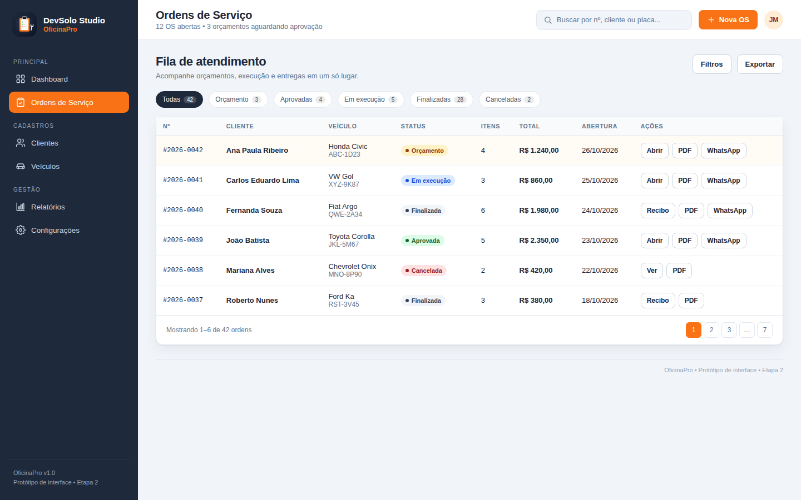
  <figcaption>Figura 8 — Ordens de Serviço: fila de atendimento com filtros por status e ações rápidas.</figcaption>
</figure>

**Objetivo:** acompanhar a fila de atendimento e agir rapidamente em cada OS.

**Componentes:** filtros por status com contadores; tabela com número, cliente, veículo, status, itens, total, abertura e ações; botões “Abrir”, “PDF”, “WhatsApp” e “Recibo”; paginação; botão “Nova OS”; filtros avançados e exportação.

**Interações:** “Abrir” leva ao editor (T05); “PDF” abre a prévia do orçamento/recibo (T06); “WhatsApp” copia ou abre a mensagem; o filtro de status é persistido ao voltar; a linha em destaque indica a OS recém-criada.

**Dados:** 42 OS no total; 3 em orçamento, 4 aprovadas, 5 em execução, 28 finalizadas e 2 canceladas. A tabela mostra 6 registros por página.

**Estados:** lista vazia com CTA “Nova OS”; OS sem itens mostra “Sem itens” e desabilita PDF; erro de transição exibe toast; loading com skeleton.

**Critérios de aceite:** os contadores refletem os filtros; o status é consistente com o diagrama de estados; as ações não exigem abrir o editor quando o documento já existe.

## 9.6 T05 — Editor de OS

<figure>
  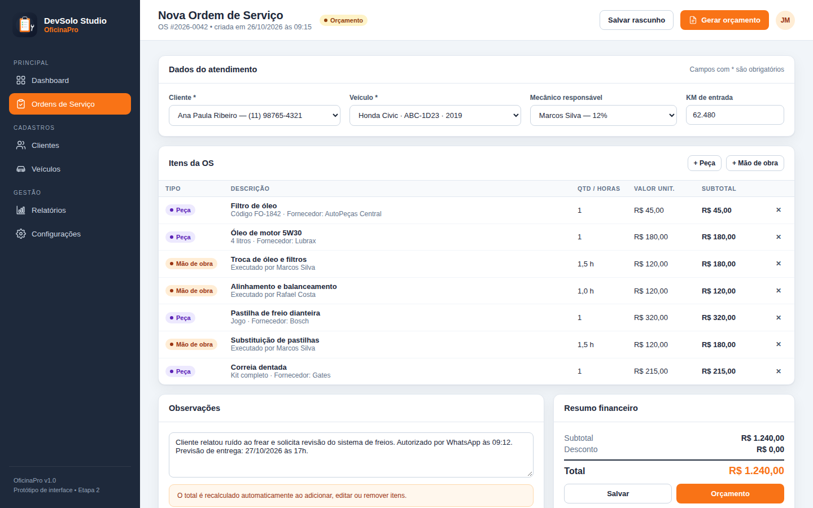
  <figcaption>Figura 9 — Editor de OS: dados do atendimento, itens de peça e mão de obra, observações e resumo financeiro.</figcaption>
</figure>

**Objetivo:** montar a OS, calcular o total e preparar o orçamento.

**Componentes:** seleção de cliente, veículo, mecânico e KM de entrada; tabela de itens com tipo, descrição, quantidade/horas, valor unitário, subtotal e remoção; botões “+ Peça” e “+ Mão de obra”; observações; resumo com subtotal, desconto e total; ações “Salvar” e “Orçamento”.

**Interações:** adicionar/remover item recalcula o total imediatamente; o botão “+ Mão de obra” herda a taxa horária padrão e o mecânico selecionado; “Salvar” persiste rascunho; “Orçamento” valida os itens e abre T06; sair com alterações não salvas pede confirmação.

**Dados:** OS #2026-0042, Ana Paula Ribeiro, Honda Civic ABC-1D23, Marcos Silva (12%), 62.480 km; 7 itens; total R$ 1.240,00. O desconto é zero neste exemplo.

**Estados:** cliente sem veículo sugere cadastro; item com valor zero é bloqueado; total negativo é impossível; se o orçamento expirar, o botão “Orçamento” vira “Revalidar”.

**Critérios de aceite:** o total é sempre recalculado pelo domínio; a OS não pode ser salva sem cliente, veículo e mecânico; a interface mostra o subtotal por item; o botão de gerar orçamento fica desabilitado sem itens.

## 9.7 T06 — Orçamento / Recibo

<figure>
  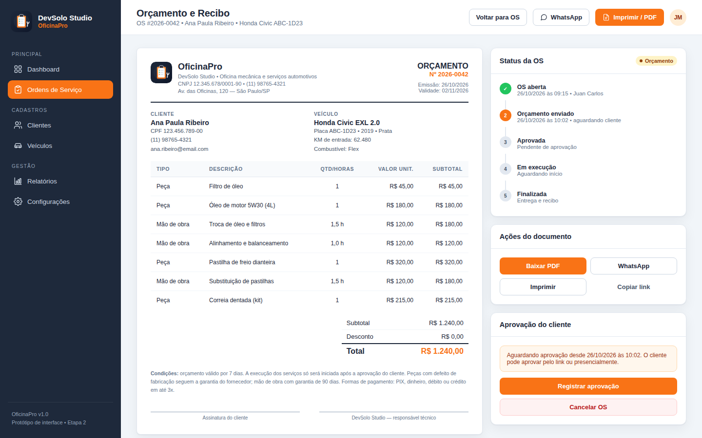
  <figcaption>Figura 10 — Orçamento / Recibo: documento A4, status da OS, ações de PDF/WhatsApp e aprovação do cliente.</figcaption>
</figure>

**Objetivo:** entregar ao cliente um documento claro e permitir que o atendente acompanhe a aprovação.

**Componentes:** prévia A4 com logo, dados da oficina, cliente, veículo, itens, totais, condições e assinaturas; painel de status com timeline; ações “Baixar PDF”, “WhatsApp”, “Imprimir” e “Copiar link”; box de aprovação com “Registrar aprovação” e “Cancelar OS”.

**Interações:** “Baixar PDF” gera o arquivo; “WhatsApp” abre `wa.me` com mensagem e link; “Imprimir” usa o diálogo do sistema; “Registrar aprovação” muda o status para `APROVADA` e libera o início; “Cancelar OS” exige motivo.

**Dados:** OS #2026-0042, 7 itens, total R$ 1.240,00, validade 02/11/2026, status `ORCAMENTO`. A timeline mostra OS aberta (concluída), orçamento enviado (atual) e etapas futuras.

**Estados:** orçamento expirado mostra aviso e bloqueia aprovação; OS finalizada troca o título para “Recibo” e oculta ações de aprovação; erro de PDF mostra toast e mantém o documento na tela.

**Critérios de aceite:** o PDF contém todos os itens e totais; o link do WhatsApp é codificado corretamente; a aprovação é registrada no histórico; o documento não quebra em A4.

## 9.8 T07 — Relatórios

<figure>
  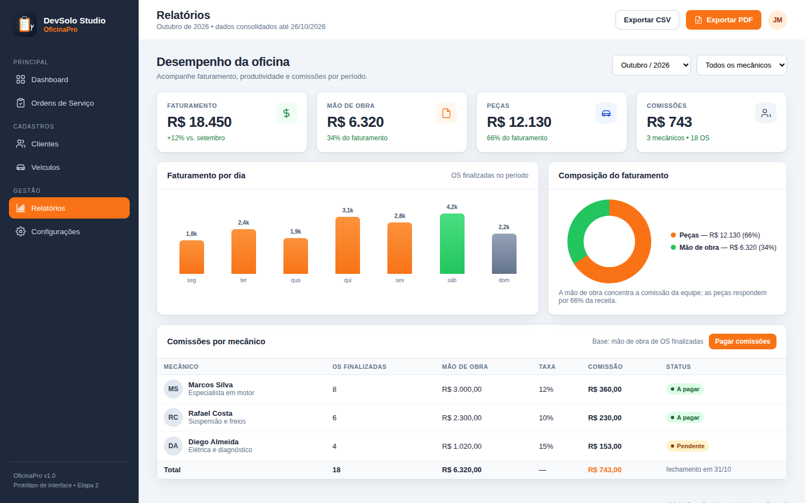
  <figcaption>Figura 11 — Relatórios: faturamento, composição por tipo e comissões por mecânico.</figcaption>
</figure>

**Objetivo:** responder “quanto faturei, quanto é peça, quanto é mão de obra e quanto devo de comissão?”.

**Componentes:** filtros de período e mecânico; cards de faturamento, mão de obra, peças e comissões; gráfico de barras por dia; donut de composição; tabela de comissões com OS, base, taxa, valor e status; botão “Pagar comissões”; exportação CSV/PDF.

**Interações:** trocar o período recalcula cards e tabela; filtrar por mecânico isola a comissão; “Pagar comissões” abre confirmação e registra o pagamento; exportar PDF gera o relatório com o período selecionado.

**Dados:** outubro/2026; faturamento R$ 18.450,00; mão de obra R$ 6.320,00 (34%); peças R$ 12.130,00 (66%); comissões R$ 743,00; 18 OS finalizadas. A tabela soma R$ 6.320,00 de base e R$ 743,00 de comissão.

**Estados:** período sem OS mostra cards zerados e mensagem “Nenhuma OS finalizada no período”; comissão pendente aparece em âmbar; comissão paga aparece em verde; erro de exportação mantém os dados na tela.

**Critérios de aceite:** os totais batem com a soma das OS finalizadas; a comissão usa a taxa do mecânico; o filtro de período inclui a data final; o relatório é exportável.

## 9.9 T08 — Configurações

<figure>
  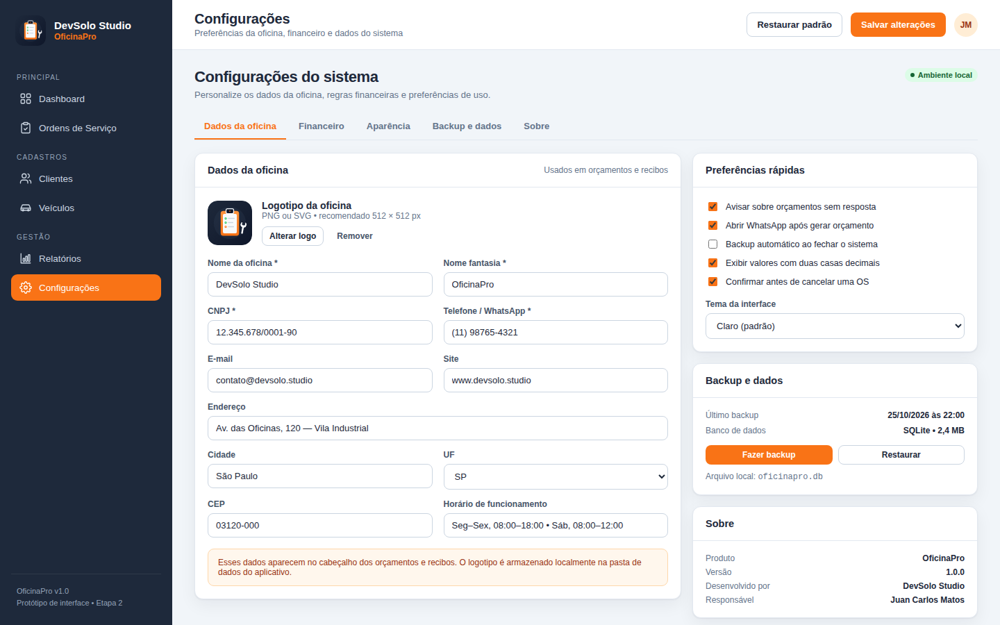
  <figcaption>Figura 12 — Configurações: dados da oficina, preferências, backup e informações do sistema.</figcaption>
</figure>

**Objetivo:** ajustar os dados que aparecem nos documentos e as preferências operacionais.

**Componentes:** abas “Dados da oficina”, “Financeiro”, “Aparência”, “Backup e dados” e “Sobre”; formulário de dados cadastrais; upload de logo; preferências rápidas; tema; backup/restauração; versão e responsável.

**Interações:** “Salvar alterações” valida e persiste; “Alterar logo” abre seletor de arquivo; “Fazer backup” gera um arquivo; “Restaurar” pede confirmação; as abas trocam o conteúdo sem perder o contexto.

**Dados:** DevSolo Studio, OficinaPro, CNPJ 12.345.678/0001-90, telefone (11) 98765-4321, endereço em São Paulo/SP; versão 1.0.0; backup de 25/10/2026.

**Estados:** CNPJ inválido bloqueia o salvamento; backup sem permissão mostra erro; restauração inválida é rejeitada; tema escuro é uma preferência, não uma reimplementação.

**Critérios de aceite:** os dados salvos aparecem no orçamento; o backup pode ser restaurado; as preferências persistem entre sessões; a aba “Sobre” identifica a equipe e a versão.

## 9.10 Protótipo navegável

<figure>
  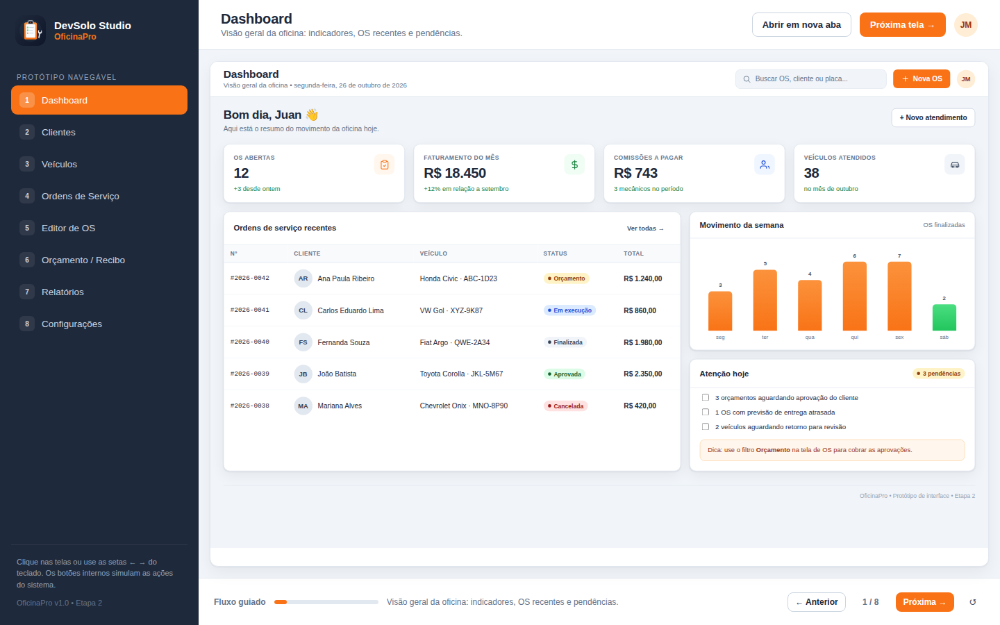
  <figcaption>Figura 13 — Protótipo navegável: sidebar com as oito telas, iframe da tela atual e fluxo guiado com botões anterior/próxima.</figcaption>
</figure>

O protótipo em `docs/etapa2/prototipo/index.html` integra as oito telas em um shell com sidebar, título contextual, botão “Abrir em nova aba” e fluxo guiado. Ele foi construído com HTML, CSS e JavaScript puros, sem dependências externas, e pode ser aberto diretamente no navegador.

**Como usar:**

1. Abra `docs/etapa2/prototipo/index.html` no Chrome, Firefox ou Edge.
2. Clique em qualquer tela na sidebar ou use as setas `←` e `→`.
3. Use “Próxima tela” para percorrer o fluxo guiado na ordem T01 → T08.
4. Clique nos botões internos para ver toasts de simulação (salvar, gerar PDF, WhatsApp etc.).
5. Use “Abrir em nova aba” para ver a tela em tamanho real (1440 × 900).

**Limitações:** o protótipo não persiste dados, não gera PDFs reais e não se conecta ao SQLite. Ele é um artefato de design e validação de fluxo; a implementação funcional ocorre na Etapa 3.

## 9.11 Checklist de usabilidade

| Heurística | Como foi tratada |
|---|---|
| Visibilidade do status | Badges, timeline, contadores e toasts |
| Correspondência com o mundo real | “OS”, “orçamento”, “mão de obra”, “comissão”, “placa” |
| Controle e liberdade | Cancelar, voltar, fechar drawer, confirmação antes de sair |
| Consistência | Mesmos componentes, cores e posições em todas as telas |
| Prevenção de erros | Validação de CPF/placa, desconto, transições e itens vazios |
| Reconhecimento em vez de memorização | Busca, filtros, sugestões e histórico visível |
| Eficiência | “Nova OS” global, ações rápidas na lista, atalhos |
| Estética minimalista | Cards, hierarquia e apenas a ação primária em laranja |
| Recuperação de erros | Mensagens claras, ação sugerida e preservação dos dados |
| Ajuda e documentação | Dicas contextuais, “Sobre” e este documento |


# 10. Fluxos de interação

## 10.1 Fluxo 1 — Abrir OS e gerar orçamento

<figure>
  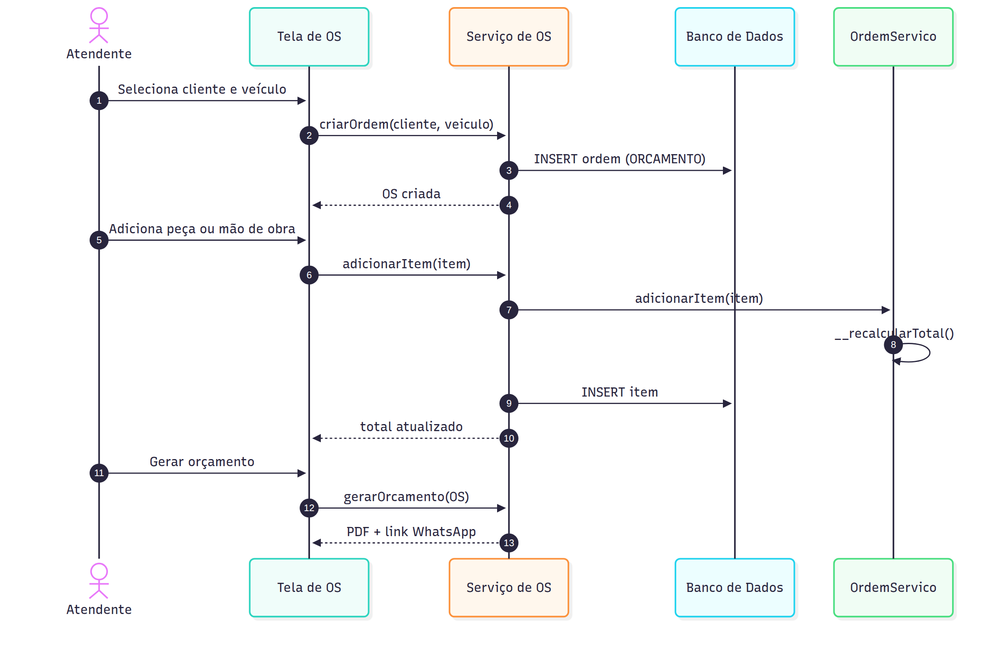
  <figcaption>Figura 14 — Sequência: seleção de cliente/veículo, criação da OS, adição de itens, recálculo e geração do orçamento.</figcaption>
</figure>

| Passo | Ator | Ação | Sistema | Resultado |
|---|---|---|---|---|
| 1 | Atendente | Seleciona cliente e veículo | Valida vínculo e dados | Contexto carregado |
| 2 | Atendente | Clica em “Nova OS” | Cria OS com status `ORCAMENTO` | Número sequencial gerado |
| 3 | Atendente | Adiciona peça ou mão de obra | Cria `Peca`/`MaoDeObra`, adiciona em `__itens` | Item na tabela |
| 4 | Sistema | Recalcula | `__recalcular_total()` | Subtotal e total atualizados |
| 5 | Atendente | Revisa e clica em “Orçamento” | Valida itens e gera PDF/link | T06 aberto |
| 6 | Atendente | Envia por WhatsApp | Monta `wa.me` com texto e link | Cliente recebe a proposta |

**Caminhos de exceção:** cliente sem veículo → sugerir cadastro; item com valor zero → bloquear; desconto maior que subtotal → erro; OS sem itens → desabilitar “Orçamento”.

## 10.2 Fluxo 2 — Aprovar, executar e finalizar

<figure>
  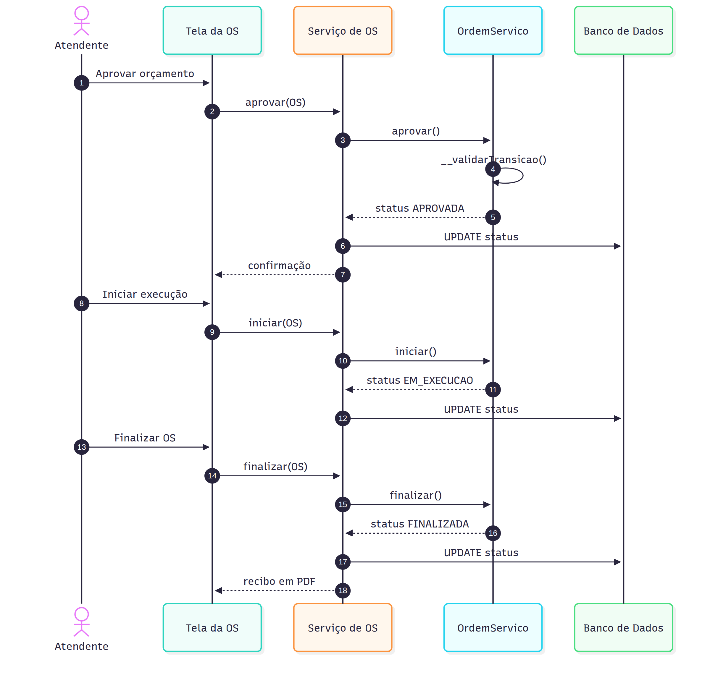
  <figcaption>Figura 15 — Sequência: aprovação do orçamento, início da execução e finalização com recibo.</figcaption>
</figure>

| Passo | Ator | Ação | Sistema | Resultado |
|---|---|---|---|---|
| 1 | Atendente | Clica em “Registrar aprovação” | `aprovar()` valida transição | Status `APROVADA` |
| 2 | Atendente | Clica em “Iniciar execução” | `iniciar()` valida responsável | Status `EM_EXECUCAO` |
| 3 | Mecânico | Executa o serviço | — | Itens concluídos |
| 4 | Atendente | Clica em “Finalizar” | `finalizar()` valida itens | Status `FINALIZADA` |
| 5 | Sistema | Gera recibo | PDF + histórico | Recibo disponível |
| 6 | Sistema | Calcula comissão | `calcularComissao()` | Valor no relatório |

**Caminhos de exceção:** aprovar OS cancelada → bloqueado; iniciar sem mecânico → bloqueado; finalizar sem itens → bloqueado; cancelar OS finalizada → bloqueado.

## 10.3 Fluxo 3 — Calcular comissões e exportar relatório

<figure>
  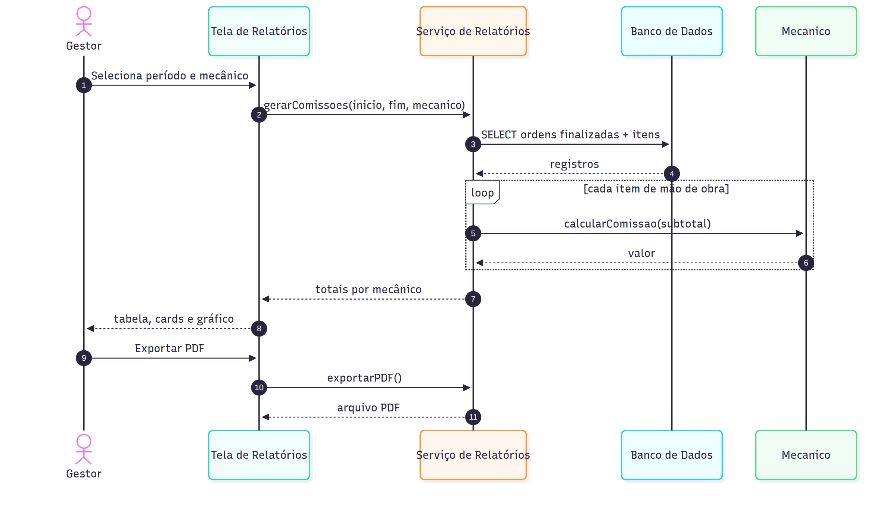
  <figcaption>Figura 16 — Sequência: filtro por período/mecânico, agregação de mão de obra e exportação do relatório.</figcaption>
</figure>

| Passo | Ator | Ação | Sistema | Resultado |
|---|---|---|---|---|
| 1 | Gestor | Seleciona período e mecânico | Valida datas | Filtro aplicado |
| 2 | Sistema | Consulta OS finalizadas | `SELECT` com `status = FINALIZADA` | Base de cálculo |
| 3 | Sistema | Percorre itens de mão de obra | `calcularComissao()` | Comissão por item |
| 4 | Sistema | Agrupa por mecânico | Soma e arredonda | Totais |
| 5 | Gestor | Exporta PDF/CSV | Gera arquivo | Relatório entregue |

**Caminhos de exceção:** período invertido → erro; nenhuma OS → cards zerados; mecânico sem comissão → linha zerada; falha de exportação → toast e dados preservados.

## 10.4 Drawers de cliente e veículo

<div class="figure-row">
  <figure>
    
    <figcaption>Figura 17 — Drawer de novo cliente: formulário, validação e ações.</figcaption>
  </figure>
  <figure>
    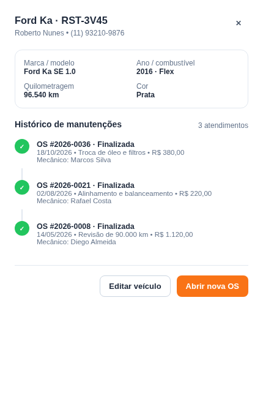
    <figcaption>Figura 18 — Drawer de histórico do veículo: dados, timeline de OS e ação de nova OS.</figcaption>
  </figure>
</div>

**Comportamento:** o drawer abre pela direita, cobre a tela com overlay escuro e mantém o contexto da lista. O foco vai para o primeiro campo; `Tab` percorre os campos; `Esc`, clique no overlay ou “Cancelar” fecham. Ao salvar, o drawer fecha, a lista é atualizada e um toast confirma. Se houver erro, o drawer permanece aberto e a mensagem aparece junto ao campo.

## 10.5 Matriz de estados de interface

| Tela | Loading | Empty | Error | Success |
|---|---|---|---|---|
| Dashboard | Skeleton nos cards | “Sem movimento hoje” | Banner de conexão | Toast ao abrir OS |
| Clientes | Skeleton nas linhas | “Nenhum cliente encontrado” | CPF duplicado | “Cliente salvo” |
| Veículos | Skeleton nas linhas | “Nenhum veículo” | Placa duplicada | “Veículo salvo” |
| Ordens | Skeleton na tabela | “Nenhuma OS no filtro” | Transição inválida | “OS atualizada” |
| Editor | Salvando… | “Adicione o primeiro item” | Valor inválido | “Rascunho salvo” |
| Orçamento | Gerando PDF… | “Orçamento sem itens” | Falha ao gerar | “PDF gerado” |
| Relatórios | Skeleton nos cards | “Sem OS no período” | Período inválido | “Relatório exportado” |
| Configurações | Salvando… | — | CNPJ inválido | “Configurações salvas” |

## 10.6 Acessibilidade dos fluxos

- Todo fluxo pode ser concluído apenas com teclado.
- O foco é visível e não fica preso atrás de drawers.
- Mensagens de erro são anunciadas por `aria-live`.
- O status da OS é lido como texto, não apenas como cor.
- O protótipo usa contraste alto e áreas de clique de pelo menos 32 px.
- Textos de ação são específicos: “Salvar cliente”, “Gerar orçamento”, “Registrar aprovação”.


# 11. Plano de testes

## 11.1 Estratégia

A validação será feita em quatro níveis:

1. **Testes unitários de domínio:** fórmulas, validações, transições e encapsulamento.
2. **Testes de integração:** repositórios SQLite, transações, chaves estrangeiras e backup.
3. **Testes de contrato dos serviços:** casos de uso de OS, orçamento, relatório e configuração.
4. **Testes manuais de interface:** navegação, formulários, drawers, estados vazios e acessibilidade.

Ferramentas previstas: `pytest` para unidade/integração, `pytest-cov` para cobertura, SQLite em memória para testes rápidos e o protótipo HTML para validação visual. A meta é **80% de cobertura** nas regras de domínio e **100% dos caminhos críticos** (abrir OS, aprovar, finalizar, calcular comissão, gerar PDF, backup).

## 11.2 Casos de teste

| ID | Cenário | Pré-condição | Passos | Resultado esperado | Prioridade |
|---|---|---|---|---|---|
| CT01 | Cadastrar cliente válido | Banco vazio | Preencher nome, telefone e CPF válidos; salvar | Cliente persistido; lista atualizada; toast de sucesso | Alta |
| CT02 | Bloquear CPF duplicado | Cliente com CPF existente | Tentar cadastrar o mesmo CPF | Erro “CPF/CNPJ já cadastrado”; nada é persistido | Alta |
| CT03 | Cadastrar veículo | Cliente ativo | Informar placa única, marca, modelo, ano e km | Veículo vinculado ao cliente | Alta |
| CT04 | Bloquear placa duplicada | Veículo existente | Cadastrar a mesma placa | Erro de unicidade; formulário permanece aberto | Alta |
| CT05 | Abrir OS | Cliente, veículo e mecânico ativos | Clicar em “Nova OS”; preencher dados | OS com status `ORCAMENTO` e número sequencial | Alta |
| CT06 | Adicionar peça e mão de obra | OS em `ORCAMENTO` | Adicionar 1 peça e 1,5 h de mão de obra | Itens na tabela; subtotais corretos | Alta |
| CT07 | Recalcular ao remover item | OS com 2 itens | Remover um item | Total recalculado; item removido | Alta |
| CT08 | Bloquear desconto inválido | OS com subtotal R$ 100 | Informar desconto R$ 150 | Erro “Desconto não pode ser maior que o subtotal” | Alta |
| CT09 | Aprovar OS | OS em `ORCAMENTO` com itens | Clicar em “Registrar aprovação” | Status `APROVADA`; histórico registrado | Alta |
| CT10 | Bloquear finalização prematura | OS em `ORCAMENTO` | Tentar finalizar | Erro de transição; status inalterado | Alta |
| CT11 | Bloquear cancelamento de finalizada | OS `FINALIZADA` | Tentar cancelar | Erro “OS finalizada não pode ser cancelada” | Alta |
| CT12 | Calcular comissão | OS finalizada com R$ 480 de mão de obra; mecânico 12% | Abrir relatório do período | Comissão R$ 57,60 | Alta |
| CT13 | Filtrar relatório | 3 mecânicos e 18 OS | Selecionar outubro e Marcos | Apenas OS/base/comissão de Marcos | Alta |
| CT14 | Gerar PDF | OS com 7 itens | Clicar em “Baixar PDF” | PDF A4 com todos os itens, totais e validade | Alta |
| CT15 | Backup e restauração | Banco com dados | Fazer backup; alterar dados; restaurar | Dados originais restaurados; integridade OK | Média |
| CT16 | Buscar cliente por placa | Cliente com veículo | Digitar a placa na busca de clientes | Cliente correspondente encontrado | Média |
| CT17 | Fechar drawer com ESC | Drawer aberto | Pressionar `Esc` | Drawer fecha; foco volta ao botão de origem | Média |
| CT18 | Navegar no protótipo | Protótipo aberto | Usar `←` e `→` | Tela anterior/próxima; título e progresso atualizados | Média |
| CT19 | Validar placa Mercosul | Formulário de veículo | Informar `ABC1D23` | Placa normalizada para `ABC-1D23` ou aceita no padrão | Média |
| CT20 | Exportar CSV | Relatório filtrado | Clicar em “Exportar CSV” | Arquivo com colunas e linhas do período | Baixa |

## 11.3 Matriz de rastreabilidade

| Requisito | Casos de teste |
|---|---|
| RF01 Clientes | CT01, CT02, CT16 |
| RF02 Veículos | CT03, CT04, CT19 |
| RF03 Abrir OS | CT05 |
| RF04 Itens | CT06, CT07 |
| RF05 Totais | CT07, CT08 |
| RF06 PDF/WhatsApp | CT14 |
| RF07 Transições | CT09, CT10, CT11 |
| RF08 Comissões | CT12 |
| RF09 Relatórios | CT13, CT20 |
| RF10 Busca/filtros | CT13, CT16 |
| RF11 Backup | CT15 |
| RF12 Configurações | CT15 |
| RF13 Histórico | CT09, CT11 |
| RF14 Dashboard | CT05, CT09 |

## 11.4 Massa de teste

| Entidade | Dados |
|---|---|
| Clientes | Ana Paula Ribeiro (CPF 123.456.789-00), Carlos Eduardo Lima (234.567.890-11) |
| Veículos | Honda Civic ABC-1D23 (2019, 62.480 km), VW Gol XYZ-9K87 (2015, 118.920 km) |
| Mecânicos | Marcos Silva (12%), Rafael Costa (10%), Diego Almeida (15%) |
| OS | #2026-0042 (orçamento, R$ 1.240,00), #2026-0041 (execução, R$ 860,00), #2026-0040 (finalizada, R$ 1.980,00) |
| Itens | Peças e mão de obra da Seção 3.4; mão de obra total de R$ 480,00 na OS de exemplo |
| Relatório | Outubro/2026: 18 OS, R$ 18.450,00 de faturamento, R$ 6.320,00 de mão de obra, R$ 743,00 de comissão |

## 11.5 Roteiro manual do protótipo

1. Abrir `docs/etapa2/prototipo/index.html`.
2. Verificar se o dashboard é a tela inicial e se o item “Dashboard” está ativo.
3. Clicar em “Nova OS” e conferir se o editor abre com cliente/veículo.
4. Adicionar um item, remover outro e observar o total.
5. Clicar em “Orçamento” e conferir a prévia A4 e a timeline.
6. Clicar em “WhatsApp” e verificar o toast de simulação.
7. Clicar em “Registrar aprovação” e conferir a mudança de status.
8. Voltar à lista de OS e testar os filtros por status.
9. Abrir Relatórios, trocar o período e conferir os cards.
10. Abrir Configurações, alternar as abas e simular backup.
11. Pressionar `←` e `→` para percorrer as oito telas.
12. Verificar se não há erros no console do navegador.

## 11.6 Critérios de conclusão

- Todos os casos de prioridade alta passam.
- Nenhum erro crítico de cálculo ou de transição.
- PDF gerado com layout A4 consistente.
- Backup restaurado com integridade verificada.
- Protótipo navegável sem links quebrados.
- Documento revisado e exportado em PDF.
- Checklist do Apêndice E completo.

## 11.7 Riscos de teste

| Risco | Impacto | Mitigação |
|---|---|---|
| PDF depende de fontes do sistema | Layout diferente em outra máquina | Embutir fontes ou usar fonte padrão; testar em Linux e Windows |
| WhatsApp abre app externo | Teste automatizado limitado | Testar a URL gerada e a codificação, não o app |
| SQLite em memória difere do arquivo | Teste não cobre WAL/lock | Rodar uma suíte de integração com arquivo temporário |
| Dados fictícios escondem casos-limite | Falhas em produção | Incluir casos com valores zero, negativos, placas antigas e nomes longos |
| Protótipo HTML não é a UI final | Divergência visual | Usar os mesmos tokens e revisar a paridade na Etapa Final |


# 12. Cronograma e riscos

## 12.1 Cronograma do projeto

| Etapa | Prazo | Frente | Entregáveis | Status |
|---|---|---|---|---|
| Etapa 1 | 22/10/2026 | Proposta e escopo | Problema, público, requisitos, classes iniciais, identidade e cronograma | Concluída |
| Etapa 2 | 29/10/2026 | Modelagem e telas | Diagrama de classes, estados, arquitetura, schema, design system, 8 wireframes, fluxos, protótipo e PDF | Concluída em 26/10/2026 |
| Etapa 3 | 05/11/2026 | Codificação central | Classes de domínio, SQLite, repositórios, serviços, cálculos e testes unitários | Planejada |
| Etapa Final | 19/11/2026 | Integração e validação | CustomTkinter, PDF, WhatsApp, testes integrados, documentação final e apresentação | Planejada |

## 12.2 Plano detalhado da Etapa 3

| Período | Atividade | Saída verificável |
|---|---|---|
| 30/10–31/10 | Implementar domínio (`Pessoa`, `Cliente`, `Mecanico`, `Veiculo`, `ItemOS`, `Peca`, `MaoDeObra`, `OrdemServico`, `StatusOS`) | Testes unitários de cálculo e transição |
| 01/11–02/11 | Criar schema SQLite, migração inicial, repositórios e backup | Banco criado; CRUD funcionando |
| 03/11 | Implementar serviços de OS, orçamento e relatório | Casos de uso cobertos por testes |
| 04/11 | Integrar uma tela piloto (Dashboard ou OS) e validar o fluxo | Primeira versão executável |
| 05/11 | Revisão, correções e entrega da Etapa 3 | Código versionado + testes verdes |

## 12.3 Plano da Etapa Final

| Período | Atividade | Saída verificável |
|---|---|---|
| 06/11–10/11 | Telas CustomTkinter (dashboard, clientes, veículos, OS) | Navegação funcional |
| 11/11–13/11 | Editor, orçamento, relatórios e configurações | Fluxo completo |
| 14/11–16/11 | PDF, WhatsApp, backup e testes de integração | Documentos e relatórios reais |
| 17/11–18/11 | Testes de aceite, correções e usabilidade | Checklist de qualidade |
| 19/11 | Entrega final e apresentação | PDF final + código + roteiro |

## 12.4 Riscos

| Risco | Prob. | Impacto | Mitigação |
|---|---|---|---|
| Escopo crescer além do MVP | Média | Alto | Congelar Must; adiar Should/Could para depois da entrega |
| Paridade visual entre HTML e CustomTkinter | Média | Alto | Criar biblioteca de componentes e revisar tela a tela |
| Layout do PDF no ReportLab | Média | Alto | Prototipar o PDF na primeira semana da Etapa 3; testar A4 |
| Erros de arredondamento financeiro | Média | Alto | Usar `Decimal`; testes com centavos e descontos |
| Concorrência/lock do SQLite | Baixa | Médio | WAL, `busy_timeout`, transações curtas |
| Perda de dados | Baixa | Alto | Backup automático, `VACUUM INTO`, restauração testada |
| Prazo apertado da Etapa 3 | Alta | Alto | Priorizar domínio + persistência + uma tela piloto; buffer no fim de semana |
| Integração com WhatsApp | Baixa | Médio | Usar `wa.me` com `urllib.parse.quote`; testar codificação |
| Ambiente sem display para testes de UI | Média | Médio | Testar lógica sem UI; usar screenshots e execução local do usuário |
| Curva de aprendizado do CustomTkinter | Média | Médio | Começar por componentes simples; reutilizar o design system |
| Dados sensíveis (CPF) | Média | Alto | Dados locais, acesso restrito, backup protegido e exclusão lógica |
| Mudanças de requisito | Média | Médio | Registrar decisões e manter rastreabilidade |

## 12.5 Critérios de priorização

- **Must:** RF01–RF08 e RF10. Sem eles, o fluxo principal não fecha.
- **Should:** RF09, RF11–RF14. Agregam valor, mas podem entrar após o MVP.
- **Could:** exportação CSV avançada, tema escuro, importação de planilha.
- **Won’t (v1.0):** multiusuário, nuvem, NF-e, estoque, app móvel.


# 13. Glossário

| Termo | Definição |
|---|---|
| **OS (Ordem de Serviço)** | Documento que registra o atendimento de um veículo, seus itens, responsável, status e valores. |
| **Orçamento** | Proposta de peças e mão de obra enviada ao cliente antes da execução. |
| **Recibo** | Documento emitido após a finalização, com os valores efetivamente cobrados. |
| **Peça** | Item físico aplicado ao veículo, com código, fornecedor, quantidade e valor unitário. |
| **Mão de obra** | Serviço executado por um mecânico, medido em horas e taxa horária. |
| **Comissão** | Percentual sobre a mão de obra das OS finalizadas, devido ao mecânico. |
| **Status** | Estado do ciclo de vida da OS: orçamento, aprovada, em execução, finalizada ou cancelada. |
| **Transição** | Passagem de um status para outro, sujeita a regras e registrada em histórico. |
| **Agregação/Composição** | Relação em que a OS contém itens; os itens não existem sem a OS. |
| **Polimorfismo** | Capacidade de tratar `Peca` e `MaoDeObra` como `ItemOS`, chamando `calcularSubtotal()` de formas diferentes. |
| **Encapsulamento** | Ocultação de detalhes internos, como `__itens` e `__recalcular_total()`. |
| **Herança** | Reaproveitamento de atributos e contratos entre superclasse e subclasse. |
| **Wireframe** | Representação visual de baixa/média fidelidade de uma tela. |
| **Protótipo navegável** | Conjunto de telas HTML interligadas para validar fluxo e usabilidade. |
| **Drawer** | Painel lateral que abre sobre a tela para cadastro ou detalhe. |
| **Toast** | Mensagem temporária de feedback no canto da tela. |
| **SQLite** | Banco de dados relacional embutido, armazenado em arquivo local. |
| **WAL** | Write-Ahead Logging, modo de journal do SQLite que melhora concorrência. |
| **Soft delete** | Exclusão lógica, mantendo o registro e marcando `ativo = 0`. |
| **UML** | Unified Modeling Language, notação para modelagem de sistemas. |
| **Mermaid** | Ferramenta de diagramas como código, usada para as fontes editáveis. |
| **A4** | Formato de papel 210 × 297 mm, usado em orçamentos e recibos. |
| **BRL** | Real brasileiro, moeda do sistema. |


# 14. Referências

ASSOCIAÇÃO BRASILEIRA DE NORMAS TÉCNICAS. **NBR 6023**: informação e documentação — referências — elaboração. Rio de Janeiro: ABNT, 2018.

OBJECT MANAGEMENT GROUP. **OMG Unified Modeling Language (UML)**, version 2.5.1. 2017. Disponível em: <https://www.omg.org/spec/UML/2.5.1/>. Acesso em: 26 out. 2026.

PYTHON SOFTWARE FOUNDATION. **Python 3.12 Documentation**. Disponível em: <https://docs.python.org/3.12/>. Acesso em: 26 out. 2026.

SQLITE CONSORTIUM. **SQLite Documentation**. Disponível em: <https://www.sqlite.org/docs.html>. Acesso em: 26 out. 2026.

NIELSEN, Jakob. **10 Usability Heuristics for User Interface Design**. Nielsen Norman Group, 1994. Disponível em: <https://www.nngroup.com/articles/ten-usability-heuristics/>. Acesso em: 26 out. 2026.

W3C. **Web Content Accessibility Guidelines (WCAG) 2.2**. 2023. Disponível em: <https://www.w3.org/TR/WCAG22/>. Acesso em: 26 out. 2026.

DEVSOLO STUDIO. **OficinaPro v1.0 — Proposta de Projeto de Software (Etapa 1)**. 2026. Documento interno.

CUSTOMTKINTER. **CustomTkinter Documentation**. Disponível em: <https://customtkinter.tomschimansky.com/>. Acesso em: 26 out. 2026.

REPORTLAB. **ReportLab User Guide**. Disponível em: <https://www.reportlab.com/docs/reportlab-userguide.pdf>. Acesso em: 26 out. 2026.

MERMAID. **Mermaid Documentation**. Disponível em: <https://mermaid.js.org/>. Acesso em: 26 out. 2026.


# 15. Apêndices

## Apêndice A — Diagrama de classes detalhado

<figure>
  
  <figcaption>Figura 19 — Diagrama de classes detalhado, com todos os atributos, métodos e multiplicidades.</figcaption>
</figure>

## Apêndice B — DDL do banco SQLite

```sql
PRAGMA foreign_keys = ON;
PRAGMA journal_mode = WAL;
PRAGMA busy_timeout = 5000;

CREATE TABLE oficina (
  id INTEGER PRIMARY KEY AUTOINCREMENT,
  nome TEXT NOT NULL,
  cnpj TEXT NOT NULL UNIQUE,
  telefone TEXT NOT NULL,
  endereco TEXT,
  taxa_horaria_padrao NUMERIC NOT NULL DEFAULT 0 CHECK (taxa_horaria_padrao >= 0),
  comissao_padrao NUMERIC NOT NULL DEFAULT 0.10 CHECK (comissao_padrao BETWEEN 0 AND 1),
  criado_em TEXT NOT NULL DEFAULT (datetime('now'))
);

CREATE TABLE cliente (
  id INTEGER PRIMARY KEY AUTOINCREMENT,
  nome TEXT NOT NULL,
  telefone TEXT NOT NULL,
  email TEXT,
  cpf_cnpj TEXT NOT NULL UNIQUE,
  endereco TEXT,
  data_nascimento TEXT,
  observacoes TEXT,
  ativo INTEGER NOT NULL DEFAULT 1 CHECK (ativo IN (0, 1)),
  criado_em TEXT NOT NULL DEFAULT (datetime('now'))
);

CREATE TABLE mecanico (
  id INTEGER PRIMARY KEY AUTOINCREMENT,
  nome TEXT NOT NULL,
  telefone TEXT NOT NULL,
  email TEXT,
  registro TEXT NOT NULL UNIQUE,
  especialidade TEXT,
  taxa_comissao NUMERIC NOT NULL DEFAULT 0.10 CHECK (taxa_comissao BETWEEN 0 AND 1),
  ativo INTEGER NOT NULL DEFAULT 1 CHECK (ativo IN (0, 1))
);

CREATE TABLE veiculo (
  id INTEGER PRIMARY KEY AUTOINCREMENT,
  cliente_id INTEGER NOT NULL REFERENCES cliente(id) ON UPDATE CASCADE ON DELETE RESTRICT,
  placa TEXT NOT NULL UNIQUE,
  marca TEXT NOT NULL,
  modelo TEXT NOT NULL,
  ano INTEGER NOT NULL CHECK (ano BETWEEN 1900 AND 2100),
  km INTEGER NOT NULL DEFAULT 0 CHECK (km >= 0),
  cor TEXT,
  combustivel TEXT,
  observacoes TEXT
);

CREATE TABLE ordem_servico (
  id INTEGER PRIMARY KEY AUTOINCREMENT,
  numero TEXT NOT NULL UNIQUE,
  cliente_id INTEGER NOT NULL REFERENCES cliente(id) ON UPDATE CASCADE ON DELETE RESTRICT,
  veiculo_id INTEGER NOT NULL REFERENCES veiculo(id) ON UPDATE CASCADE ON DELETE RESTRICT,
  mecanico_id INTEGER NOT NULL REFERENCES mecanico(id) ON UPDATE CASCADE ON DELETE RESTRICT,
  status TEXT NOT NULL DEFAULT 'ORCAMENTO'
    CHECK (status IN ('ORCAMENTO', 'APROVADA', 'EM_EXECUCAO', 'FINALIZADA', 'CANCELADA')),
  desconto NUMERIC NOT NULL DEFAULT 0 CHECK (desconto >= 0),
  data_abertura TEXT NOT NULL DEFAULT (datetime('now')),
  data_aprovacao TEXT,
  data_inicio TEXT,
  data_finalizacao TEXT,
  data_cancelamento TEXT,
  motivo_cancelamento TEXT,
  observacoes TEXT,
  criado_por TEXT
);

CREATE TABLE item_os (
  id INTEGER PRIMARY KEY AUTOINCREMENT,
  ordem_servico_id INTEGER NOT NULL REFERENCES ordem_servico(id) ON UPDATE CASCADE ON DELETE CASCADE,
  tipo TEXT NOT NULL CHECK (tipo IN ('PECA', 'MAO_DE_OBRA')),
  descricao TEXT NOT NULL,
  quantidade NUMERIC NOT NULL DEFAULT 1 CHECK (quantidade > 0),
  valor_unitario NUMERIC NOT NULL DEFAULT 0 CHECK (valor_unitario >= 0),
  horas NUMERIC CHECK (horas IS NULL OR horas > 0),
  taxa_horaria NUMERIC CHECK (taxa_horaria IS NULL OR taxa_horaria >= 0),
  mecanico_id INTEGER REFERENCES mecanico(id) ON UPDATE CASCADE ON DELETE SET NULL,
  codigo_peca TEXT,
  fornecedor TEXT,
  CHECK (
    (tipo = 'PECA' AND horas IS NULL AND taxa_horaria IS NULL)
    OR
    (tipo = 'MAO_DE_OBRA' AND horas IS NOT NULL AND taxa_horaria IS NOT NULL)
  )
);

CREATE TABLE status_historico (
  id INTEGER PRIMARY KEY AUTOINCREMENT,
  ordem_servico_id INTEGER NOT NULL REFERENCES ordem_servico(id) ON UPDATE CASCADE ON DELETE CASCADE,
  status_anterior TEXT CHECK (status_anterior IS NULL OR status_anterior IN
    ('ORCAMENTO', 'APROVADA', 'EM_EXECUCAO', 'FINALIZADA', 'CANCELADA')),
  status_novo TEXT NOT NULL CHECK (status_novo IN
    ('ORCAMENTO', 'APROVADA', 'EM_EXECUCAO', 'FINALIZADA', 'CANCELADA')),
  data_hora TEXT NOT NULL DEFAULT (datetime('now')),
  usuario TEXT,
  motivo TEXT
);

CREATE TABLE configuracao (
  chave TEXT PRIMARY KEY,
  valor TEXT,
  atualizado_em TEXT NOT NULL DEFAULT (datetime('now'))
);

CREATE TABLE comissao_pagamento (
  id INTEGER PRIMARY KEY AUTOINCREMENT,
  mecanico_id INTEGER NOT NULL REFERENCES mecanico(id) ON UPDATE CASCADE ON DELETE RESTRICT,
  periodo_inicio TEXT NOT NULL,
  periodo_fim TEXT NOT NULL,
  valor NUMERIC NOT NULL CHECK (valor >= 0),
  pago_em TEXT NOT NULL DEFAULT (datetime('now')),
  observacoes TEXT
);

CREATE INDEX idx_cliente_nome ON cliente(nome);
CREATE INDEX idx_veiculo_placa ON veiculo(placa);
CREATE INDEX idx_os_status ON ordem_servico(status);
CREATE INDEX idx_os_data_abertura ON ordem_servico(data_abertura);
CREATE INDEX idx_item_os_os ON item_os(ordem_servico_id);
CREATE INDEX idx_item_os_mecanico ON item_os(mecanico_id);
```

> **Nota:** o `CHECK` de `desconto` não compara com a soma dos itens porque esse valor depende de outra tabela. A validação `desconto <= subtotal` é feita no domínio, em `__recalcular_total()`.

## Apêndice C — Programa principal mínimo

A prévia completa está na Seção 4.7. O esqueleto abaixo resume a execução mínima com dois objetos de cada entidade central:

```python
def main() -> None:
    oficina = Oficina("DevSolo Studio", "12.345.678/0001-90", Decimal("120.00"))
    mecanico = Mecanico("Marcos Silva", "(11) 98888-0001", "MEC-001", Decimal("0.12"))

    ana = Cliente("Ana Paula Ribeiro", "(11) 98765-4321", "123.456.789-00")
    carlos = Cliente("Carlos Eduardo Lima", "(11) 97654-3210", "234.567.890-11")

    civic = Veiculo("ABC-1D23", "Honda", "Civic", 2019, 62480, ana)
    gol = Veiculo("XYZ-9K87", "Volkswagen", "Gol", 2015, 118920, carlos)

    os1 = oficina.emitir_ordem_servico(ana, civic, mecanico)
    os1.adicionar_item(Peca("Filtro de óleo", 1, Decimal("45.00"), "FO-1842", "AutoPeças Central"))
    os1.adicionar_item(MaoDeObra("Troca de óleo", Decimal("1.5"), Decimal("120.00"), mecanico))

    os2 = oficina.emitir_ordem_servico(carlos, gol, mecanico)
    os2.adicionar_item(Peca("Pastilha de freio", 1, Decimal("320.00"), "PF-2210", "Bosch"))
    os2.adicionar_item(MaoDeObra("Substituição de pastilhas", Decimal("1.5"), Decimal("120.00"), mecanico))

    print(os1.resumo())
    print(os2.resumo())
```

## Apêndice D — Fontes Mermaid e reprodução

| Arquivo | Conteúdo |
|---|---|
| `diagramas/classes-visao-geral.mmd` | Visão geral das classes |
| `diagramas/classes-detalhado.mmd` | Diagrama detalhado em Mermaid |
| `diagramas/classes-overview-compact.mmd` | Visão compacta para anexos |
| `diagramas/estados-os.mmd` | Estados da OS em Mermaid |
| `diagramas/estados-os-compacto.mmd` | Estados em versão compacta |
| `diagramas/er-sqlite.mmd` | Modelo ER em Mermaid |
| `diagramas/er-sqlite-compacto.mmd` | ER compacto |
| `diagramas/navegacao.mmd` | Mapa de navegação em Mermaid |
| `diagramas/navegacao-compacto.mmd` | Navegação compacta |
| `diagramas/seq-abrir-os-simples.mmd` | Sequência de abertura de OS |
| `diagramas/seq-aprovar-finalizar-simples.mmd` | Sequência de aprovação/finalização |
| `diagramas/seq-comissoes-simples.mmd` | Sequência de comissões |
| `diagramas/arquitetura.mmd` | Arquitetura em camadas |

Comando de renderização Mermaid usado no projeto:

```bash
mmdc -i diagramas/arquitetura.mmd -o diagramas/arquitetura.png \
  --size 1200 -s 2 -b white -p diagramas/puppeteer-config.json
```

O diagrama de classes principal é gerado por script próprio:

```bash
python3 ferramentas/gerar_diagrama_classes.py
node /tmp/opencode/docgen/svg2png.mjs diagramas/classes-compacto.svg diagramas/classes-compacto.png 2
```

## Apêndice E — Checklist da Etapa 2

| Exigência | Evidência | Status |
|---|---|---|
| Documentação em Markdown + Mermaid | Este arquivo + fontes `.mmd` | ✅ |
| Pelo menos 5 classes | 9 classes + 1 enum | ✅ |
| Herança | `Pessoa → Cliente/Mecanico`; `ItemOS → Peca/MaoDeObra` | ✅ |
| Polimorfismo | `ItemOS.calcularSubtotal()` | ✅ |
| Associação | `Cliente–Veiculo–OrdemServico–ItemOS` | ✅ |
| Atributo privado | `OrdemServico.__itens` | ✅ |
| Método privado | `OrdemServico.__recalcular_total()` | ✅ |
| Programa principal com 2+ objetos | Seção 4.7 e Apêndice C | ✅ |
| Diagrama de classes | Figuras 1, 2 e 19 | ✅ |
| Diagrama de estados | Figura 3 | ✅ |
| Wireframes | 8 telas (Figuras 5–12) | ✅ |
| Mapa de navegação | Seção 8 | ✅ |
| Fluxos de interação | Seção 10 | ✅ |
| Plano de testes | Seção 11 | ✅ |
| Cronograma e riscos | Seção 12 | ✅ |
| PDF para submissão | `Etapa2_Modelagem_e_Interfaces.pdf` | ✅ |
| Protótipo navegável | `prototipo/index.html` | ✅ |
| Ambiente Linux | Capturas e PDF gerados em Linux | ✅ |
| Prazo 29/10/2026 | Concluído em 26/10/2026 | ✅ |

## Apêndice F — Mapa de arquivos

```text
oficinapro/
├── Etapa 1.pdf
├── assets/
│   ├── logo.svg
│   ├── logo.png
│   ├── logo-horizontal.svg
│   └── logo-horizontal.png
└── docs/etapa2/
    ├── Etapa2_Modelagem_e_Interfaces.md
    ├── Etapa2_Modelagem_e_Interfaces.html
    ├── Etapa2_Modelagem_e_Interfaces.pdf
    ├── README.md
    ├── diagramas/
    │   ├── classes-compacto.svg/png
    │   ├── classes-detalhado.svg/png
    │   ├── estados-os.svg/png
    │   ├── arquitetura.png
    │   ├── seq-*-1200.png
    │   └── *.mmd
    ├── capturas/
    │   ├── t01-dashboard.png
    │   ├── t02-clientes-lista.png
    │   ├── t02-clientes-drawer.png
    │   ├── t02-clientes-drawer-pdf.png
    │   ├── t03-veiculos-lista.png
    │   ├── t03-veiculos-drawer.png
    │   ├── t03-veiculos-drawer-pdf.png
    │   ├── t04-ordens-servico.png
    │   ├── t05-editor-os.png
    │   ├── t06-orcamento-recibo.png
    │   ├── t07-relatorios.png
    │   ├── t08-configuracoes.png
    │   └── prototipo.png
    ├── wireframes/
    │   ├── base.css
    │   ├── app.js
    │   └── t01..t08.html
    ├── prototipo/
    │   └── index.html
    └── ferramentas/
        ├── gerar_diagrama_classes.py
        └── gerar_pdf.mjs
```

## Apêndice G — Premissas e limitações

1. Os dados dos wireframes são fictícios e servem para validar layout, não persistência.
2. O protótipo HTML não é a interface final; a implementação será em CustomTkinter.
3. O PDF do protótipo é uma prévia de design; a aplicação final usará ReportLab.
4. A integração com WhatsApp usa link `wa.me`, sem API oficial.
5. O sistema v1.0 é monousuário e local; não há controle de permissões.
6. O modelo didático usa `float`; a implementação deve usar `Decimal`.
7. A validade padrão do orçamento é 7 dias, configurável.
8. A comissão considera apenas mão de obra de OS finalizadas.
9. O banco pode ser restaurado, mas a restauração exige confirmação e app fechado.
10. O cronograma da Etapa 3 é apertado; o escopo Must tem prioridade.

<div class="closing">
  
  <p><strong>DevSolo Studio</strong> • OficinaPro v1.0</p>
  <p>Documento de modelagem e interfaces • Etapa 2 • 26/10/2026</p>
  <p class="muted">“Menos papel, mais clareza. Menos retrabalho, mais confiança.”</p>
</div>


