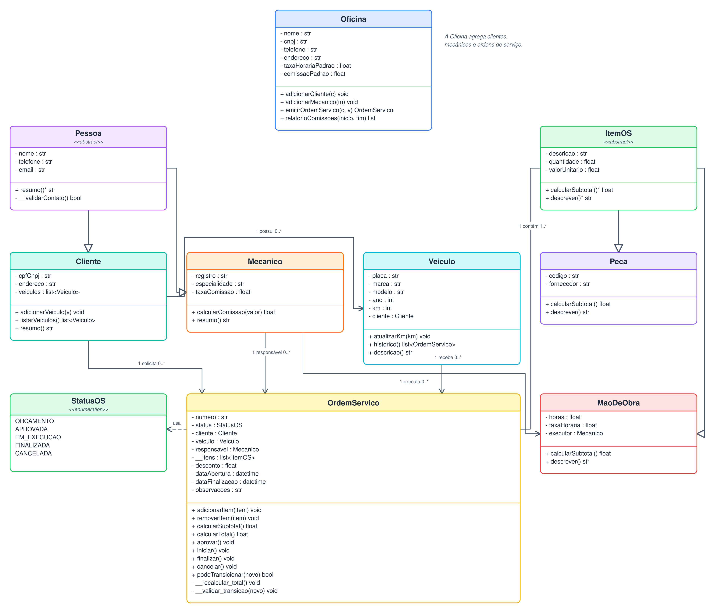
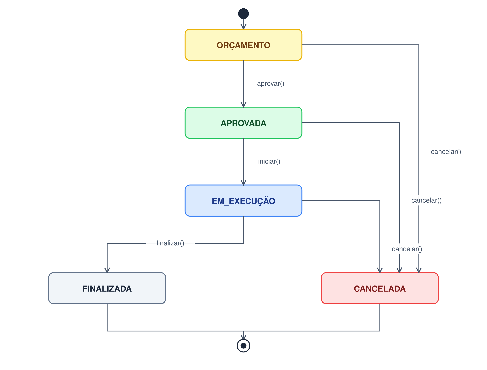
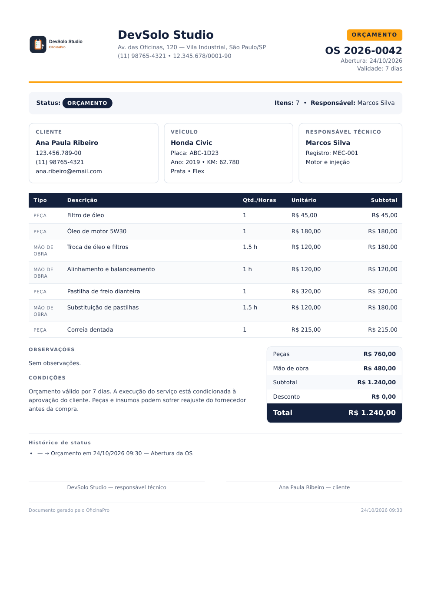
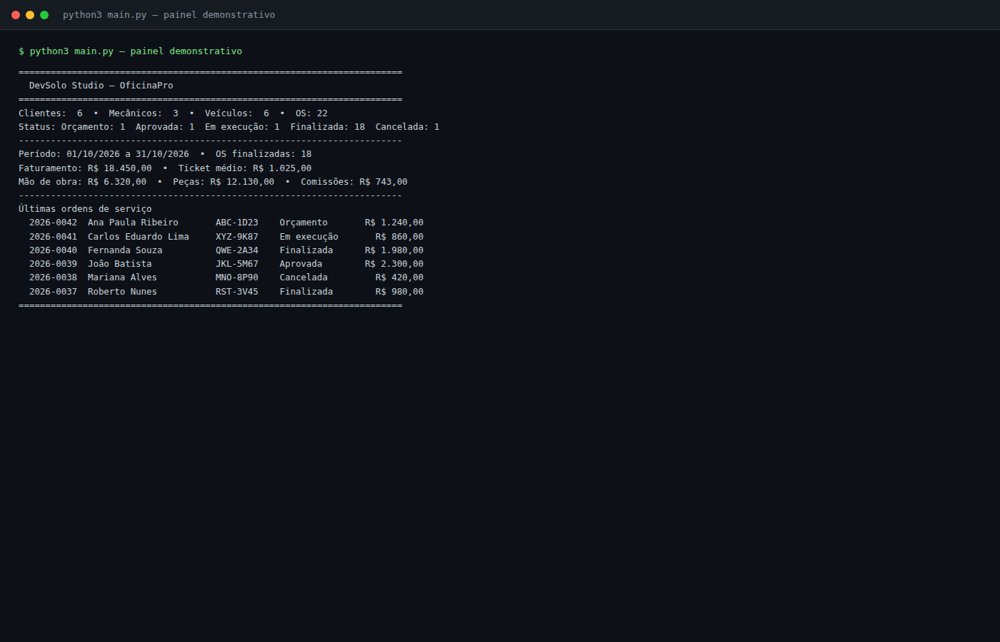
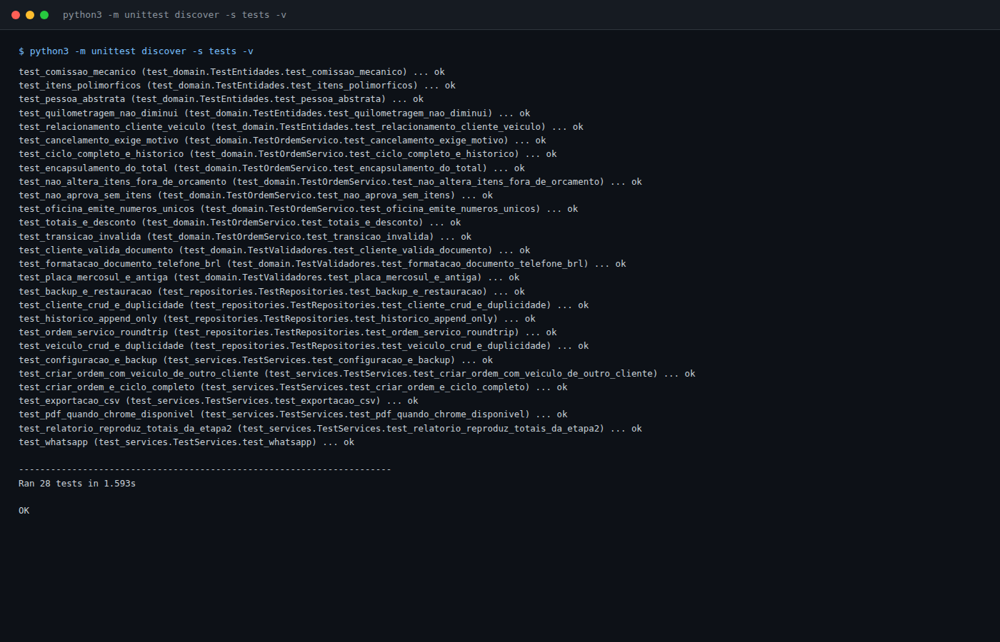

<div class="cover">
  
  <div class="cover-kicker">AVALIAÇÃO G2 • ETAPA 3</div>
  <h1 class="cover-title">OficinaPro <span>v1.0</span></h1>
  <div class="cover-subtitle">Implementação do Núcleo</div>
  <p class="cover-lead">Domínio orientado a objetos, persistência SQLite, serviços de aplicação, relatórios gerenciais, orçamento em PDF e integração com WhatsApp — com 28 testes automatizados.</p>
  <div class="cover-meta">
    <div><strong>Equipe</strong><br>DevSolo Studio</div>
    <div><strong>Integrante</strong><br>Juan Carlos Matos</div>
    <div><strong>Entrega</strong><br>05/11/2026</div>
  </div>
  <div class="cover-footer">Python 3.12+ • SQLite • unittest • Chrome headless • CustomTkinter (Etapa Final)</div>
</div>

<div class="page-break"></div>

# Sumário

1. [Introdução](#1-introdução)
2. [Visão geral da solução](#2-visão-geral-da-solução)
3. [Domínio](#3-domínio)
4. [Persistência](#4-persistência)
5. [Serviços de aplicação](#5-serviços-de-aplicação)
6. [Geração de PDF](#6-geração-de-pdf)
7. [Interface CLI e execução](#7-interface-cli-e-execução)
8. [Testes e qualidade](#8-testes-e-qualidade)
9. [Decisões e trade-offs](#9-decisões-e-trade-offs)
10. [Limitações e próximos passos](#10-limitações-e-próximos-passos)
11. [Conclusão](#11-conclusão)
12. [Referências](#12-referências)

# 1. Introdução

## 1.1 Contexto

A Etapa 1 definiu o problema e o escopo do OficinaPro. A Etapa 2 consolidou o contrato de modelagem e interface: classes, regras de negócio, diagrama de estados, arquitetura de persistência, design system, wireframes e protótipo navegável. A Etapa 3 transforma esse contrato em **software executável**.

O núcleo implementado cobre o fluxo completo de uma oficina de bairro:

1. cadastrar clientes, veículos e mecânicos;
2. abrir uma ordem de serviço;
3. adicionar peças e mão de obra;
4. calcular subtotais, desconto e total;
5. aprovar, iniciar, finalizar ou cancelar a OS;
6. gerar um orçamento em PDF;
7. compartilhar o orçamento por WhatsApp;
8. apurar faturamento, peças, mão de obra e comissões por período;
9. realizar backup e restauração do banco.

## 1.2 Objetivo da Etapa 3

O objetivo é entregar um **núcleo executável, testável e documentado**, preservando as decisões da Etapa 2 e preparando a integração com a interface CustomTkinter da Etapa Final.

| Objetivo | Resultado |
|---|---|
| Implementar o domínio | 13 arquivos em `domain/`, com classes abstratas, entidades, enumeração e validadores |
| Implementar persistência | SQLite com 9 tabelas, chaves estrangeiras, índices e migração versionada |
| Implementar casos de uso | Serviços de OS, orçamento, relatórios, configuração e WhatsApp |
| Implementar relatórios | Faturamento, mão de obra, peças, ticket médio e comissões por mecânico |
| Implementar PDF | Orçamento em A4 com identidade visual do projeto |
| Implementar testes | 28 testes automatizados com `unittest` |
| Preservar a Etapa 2 | Nenhum arquivo da Etapa 2 foi alterado; a Etapa 3 tem documentação própria |

## 1.3 Escopo entregue

- **Domínio:** `Pessoa`, `Cliente`, `Mecanico`, `Veiculo`, `ItemOS`, `Peca`, `MaoDeObra`, `OrdemServico`, `Oficina`, `StatusOS`, `StatusHistorico`.
- **Persistência:** `Database`, `migrations.py`, repositórios de cliente, mecânico, veículo, OS, oficina e configuração, além de `seed.py` e `backup.py`.
- **Aplicação:** `OrdemServicoService`, `OrcamentoService`, `RelatorioService`, `ConfiguracaoService` e `whatsapp.py`.
- **Infraestrutura de saída:** geração de PDF via HTML + Chrome headless.
- **Entrada:** `main.py` com painel demonstrativo e comandos de relatório, PDF, WhatsApp e backup.
- **Qualidade:** testes de domínio, persistência, serviços, relatórios, backup e PDF.

## 1.4 Ficha do documento

| Item | Conteúdo |
|---|---|
| Projeto | OficinaPro v1.0 |
| Etapa | Etapa 3 — Implementação do Núcleo |
| Equipe | DevSolo Studio |
| Integrante | Juan Carlos Matos |
| Ambiente de desenvolvimento | Python 3.14.4, SQLite 3, Chrome 156 headless, Linux |
| Ambiente previsto para a interface | Python 3.12+, CustomTkinter 5.x |
| Testes | `unittest` (stdlib), 28 casos |
| Entrega | 05/11/2026 |
| Status | Concluído para submissão |
| Documento | `docs/etapa3/Etapa3_Implementacao.md` |
| PDF | `docs/etapa3/Etapa3_Implementacao.pdf` |

> **Observação sobre o ambiente:** a máquina usada no desenvolvimento não possui `pip`, `tkinter`, `customtkinter`, `reportlab` nem `pytest`. Por isso o núcleo usa apenas a biblioteca padrão, os testes usam `unittest` e o PDF é gerado com Chrome headless. A interface CustomTkinter será implementada e validada na Etapa Final, em ambiente com as dependências instaladas.

# 2. Visão geral da solução

## 2.1 Arquitetura em camadas

A implementação mantém a separação definida na Etapa 2:

- **Domínio:** regras puras, sem dependência de SQLite, PDF ou interface.
- **Aplicação:** casos de uso que orquestram domínio e repositórios.
- **Infraestrutura:** SQLite, mapeamento de linhas, seed, backup, PDF e links.
- **Apresentação:** CLI nesta etapa; CustomTkinter na Etapa Final.

<figure>
  
  <figcaption>Figura 1 — Arquitetura em camadas, com a apresentação consumindo os serviços de aplicação.</figcaption>
</figure>

A dependência aponta sempre para dentro: a infraestrutura conhece o domínio, mas o domínio não conhece a infraestrutura. Os serviços de aplicação recebem repositórios por injeção de dependência, o que facilita testes com banco em memória e permite substituir o gerador de PDF.

## 2.2 Estrutura de diretórios

```text
oficinapro/
├── main.py
├── pyproject.toml
├── requirements.txt
├── requirements-ui.txt
├── domain/
│   ├── exceptions.py
│   ├── validators.py
│   ├── status_os.py
│   ├── status_historico.py
│   ├── pessoa.py
│   ├── cliente.py
│   ├── mecanico.py
│   ├── veiculo.py
│   ├── item_os.py
│   ├── peca.py
│   ├── mao_de_obra.py
│   ├── ordem_servico.py
│   └── oficina.py
├── application/
│   ├── ordem_servico_service.py
│   ├── orcamento_service.py
│   ├── relatorio_service.py
│   ├── configuracao_service.py
│   └── whatsapp.py
├── infrastructure/
│   ├── database.py
│   ├── migrations.py
│   ├── seed.py
│   ├── backup.py
│   ├── repositories/
│   └── pdf/
├── tests/
│   ├── test_domain.py
│   ├── test_repositories.py
│   └── test_services.py
├── assets/
├── docs/
│   ├── etapa2/
│   └── etapa3/
└── orcamentos/
```

## 2.3 Fluxo principal

```text
Cliente/Veículo/Mecânico
        │
        ▼
OrdemServicoService.criar_ordem()
        │
        ▼
OrdemServico (ORCAMENTO)
        │  adicionar_peca() / adicionar_mao_de_obra()
        ▼
OrcamentoService.gerar_pdf() ──► PDF
        │
        ├── WhatsApp (wa.me)
        ▼
aprovar() ──► iniciar() ──► finalizar(km_saida)
        │                         │
        │                         ▼
        │                  Veículo.km atualizado
        ▼
RelatorioService.resumo() / comissoes_por_mecanico()
```

# 3. Domínio

## 3.1 Classes e responsabilidades

<figure>
  
  <figcaption>Figura 2 — Diagrama de classes implementado. A modelagem é a mesma contratada na Etapa 2.</figcaption>
</figure>

| Classe | Responsabilidade principal |
|---|---|
| `Pessoa` (abstrata) | Nome, telefone, e-mail e validação de contato |
| `Cliente` | CPF/CNPJ, endereço, data de nascimento, soft delete e coleção de veículos |
| `Mecanico` | Registro, especialidade, taxa de comissão e cálculo de comissão |
| `Veiculo` | Placa, marca, modelo, ano, KM e vínculo com cliente |
| `ItemOS` (abstrata) | Contrato de descrição, quantidade, valor unitário e subtotal |
| `Peca` | Subtotal por quantidade × valor unitário |
| `MaoDeObra` | Subtotal por horas × taxa horária e executor |
| `OrdemServico` | Agregado raiz, itens, desconto, total, status e histórico |
| `Oficina` | Configuração e emissão de números de OS |
| `StatusOS` | Enumeração do ciclo de vida |
| `StatusHistorico` | Registro imutável de transição |

## 3.2 Herança e polimorfismo

A herança é exercitada em dois eixos, conforme a Etapa 2:

```python
# Pessoa → Cliente / Mecanico
class Pessoa(ABC):
    @abstractmethod
    def tipo(self) -> str: ...

# ItemOS → Peca / MaoDeObra
class ItemOS(ABC):
    @abstractmethod
    def calcular_subtotal(self) -> Decimal: ...

class Peca(ItemOS):
    def calcular_subtotal(self) -> Decimal:
        return (self.quantidade * self.valor_unitario).quantize(Decimal("0.01"))

class MaoDeObra(ItemOS):
    def calcular_subtotal(self) -> Decimal:
        return (self.horas * self.taxa_horaria).quantize(Decimal("0.01"))
```

A `OrdemServico` não precisa conhecer o tipo concreto para calcular o total: ela percorre `self.__itens` e chama `calcular_subtotal()`. O mesmo vale para `subtotal_pecas` e `subtotal_mao_obra`, que usam `item.tipo()`.

## 3.3 Encapsulamento e invariantes

O agregado `OrdemServico` mantém:

- `__itens`: lista privada de itens;
- `__subtotal`: soma dos itens;
- `__total`: subtotal menos desconto;
- `_historico`: lista de transições;
- `_status`: estado atual.

Os totais são expostos por propriedades somente leitura. Tentar atribuir `ordem.total = ...` levanta `AttributeError`, coberto pelo teste `test_encapsulamento_do_total`.

Invariantes implementadas:

- o veículo deve pertencer ao cliente da OS;
- o desconto não pode superar o subtotal;
- a aprovação exige pelo menos um item e total maior que zero;
- itens só podem ser alterados em `ORCAMENTO`;
- o cancelamento exige motivo com pelo menos três caracteres;
- a quilometragem não pode diminuir;
- `FINALIZADA` e `CANCELADA` são terminais;
- `data_finalizacao` só existe em OS finalizada; `data_cancelamento` só existe em OS cancelada.

## 3.4 Valores monetários com Decimal

A Etapa 2 recomendava `Decimal` na implementação. A Etapa 3 adota essa recomendação em todos os cálculos financeiros:

```python
_CENTAVOS = Decimal("0.01")

def __recalcular_total(self) -> None:
    subtotal = sum((item.calcular_subtotal() for item in self.__itens), Decimal("0.00"))
    subtotal = subtotal.quantize(_CENTAVOS)
    if self._desconto > subtotal:
        raise RegraNegocioError("Desconto não pode ser maior que o subtotal.")
    self.__subtotal = subtotal
    self.__total = (subtotal - self._desconto).quantize(_CENTAVOS)
```

O arredondamento usa `ROUND_HALF_UP`, evitando os erros de ponto flutuante que apareceriam com `float`.

## 3.5 Status e transições

<figure>
  
  <figcaption>Figura 3 — Ciclo de vida da OS implementado no domínio.</figcaption>
</figure>

A tabela de transições fica explícita no código:

```python
_TRANSICOES = {
    StatusOS.ORCAMENTO: {StatusOS.APROVADA, StatusOS.CANCELADA},
    StatusOS.APROVADA: {StatusOS.EM_EXECUCAO, StatusOS.CANCELADA},
    StatusOS.EM_EXECUCAO: {StatusOS.FINALIZADA, StatusOS.CANCELADA},
    StatusOS.FINALIZADA: set(),
    StatusOS.CANCELADA: set(),
}
```

Cada transição registra um `StatusHistorico` com status anterior, novo status, data/hora, usuário e motivo. O método privado `__validar_transicao()` impede saltos e retrocessos.

## 3.6 Histórico append-only

O histórico é uma lista de objetos imutáveis (`@dataclass(frozen=True)`). O repositório não apaga registros: ao salvar uma OS já existente, ele conta quantos registros existem no banco e insere apenas os novos.

```python
existentes = conn.execute(
    "SELECT COUNT(*) FROM status_historico WHERE ordem_servico_id = ?",
    (ordem.id,),
).fetchone()[0]
for registro in ordem.historico[existentes:]:
    conn.execute("INSERT INTO status_historico ...", (...))
```

O teste `test_historico_append_only` salva a mesma OS duas vezes após a aprovação e confirma que existem exatamente dois registros.

# 4. Persistência

## 4.1 SQLite e schema

O banco é criado automaticamente por `infrastructure/migrations.py`. A versão do schema é registrada em `PRAGMA user_version = 1`.

| Tabela | Finalidade |
|---|---|
| `oficina` | Dados e parâmetros da oficina |
| `cliente` | Cadastro de clientes, com soft delete |
| `mecanico` | Cadastro de mecânicos e taxa de comissão |
| `veiculo` | Veículos vinculados a clientes |
| `ordem_servico` | Cabeçalho da OS, status, datas e desconto |
| `item_os` | Itens polimórficos (`PECA` / `MAO_DE_OBRA`) |
| `status_historico` | Trilha append-only de transições |
| `comissao_pagamento` | Reservado para registro de pagamentos de comissão |
| `configuracao` | Pares chave-valor da aplicação |

Decisões de modelagem:

- **Herança em tabela única:** `item_os` usa a coluna `tipo` para distinguir peça e mão de obra, mantendo a leitura simples e o histórico em uma única tabela.
- **Valores monetários como `TEXT`:** SQLite não possui `DECIMAL` nativo; os valores são gravados como texto e convertidos para `Decimal` no mapeamento.
- **Soft delete:** clientes e mecânicos possuem `ativo`; a exclusão física não é usada.
- **Chaves estrangeiras:** `PRAGMA foreign_keys = ON` é ativado em toda conexão.
- **Índices:** cliente/nome, veículo/cliente, OS/status, OS/data de abertura, OS/data de finalização, itens/OS e histórico/OS.

## 4.2 Migração e integridade

`Database` encapsula a conexão, ativa `foreign_keys`, `busy_timeout` e tenta `journal_mode = WAL`. O método `migrate()` executa o DDL idempotente e grava a versão. Se o banco tiver uma versão superior à suportada, a aplicação falha com mensagem explícita.

O backup usa `VACUUM INTO`, que produz uma cópia consistente sem parar a aplicação. A restauração valida `PRAGMA integrity_check` antes de substituir o arquivo e reabrir a conexão.

## 4.3 Repositórios

| Repositório | Operações principais |
|---|---|
| `ClienteRepository` | salvar, buscar por id/documento, listar com busca, inativar, reativar, contar |
| `MecanicoRepository` | salvar, buscar por id/registro, listar, inativar, contar |
| `VeiculoRepository` | salvar, buscar por id/placa, listar por cliente, atualizar KM, contar |
| `OrdemServicoRepository` | salvar agregado, buscar por número, listar com filtros, listar finalizadas, contar por status, próximo número |
| `OficinaRepository` | salvar e obter configuração da oficina |
| `ConfiguracaoRepository` | obter, definir, listar e remover chaves |

O `OrdemServicoRepository` é o mais complexo: salva cabeçalho, recria itens e acrescenta histórico. A leitura reconstrói o agregado completo, incluindo cliente, veículo, mecânico, itens e histórico.

## 4.4 Seed e totais da Etapa 2

A seed `infrastructure/seed.py` cria 6 clientes, 3 mecânicos, 6 veículos e 22 OS. As 18 OS finalizadas reproduzem exatamente os totais da Etapa 2:

| Indicador | Valor |
|---|---:|
| Faturamento | R$ 18.450,00 |
| Mão de obra | R$ 6.320,00 |
| Peças | R$ 12.130,00 |
| Comissões | R$ 743,00 |
| OS finalizadas | 18 |

| Mecânico | OS | Mão de obra | Taxa | Comissão |
|---|---:|---:|---:|---:|
| Marcos Silva | 8 | R$ 3.000,00 | 12% | R$ 360,00 |
| Rafael Costa | 6 | R$ 2.300,00 | 10% | R$ 230,00 |
| Diego Almeida | 4 | R$ 1.020,00 | 15% | R$ 153,00 |

As quatro OS recentes usadas nos wireframes também estão presentes:

| OS | Cliente | Veículo | Status | Total |
|---|---|---|---|---:|
| 2026-0042 | Ana Paula Ribeiro | Honda Civic ABC-1D23 | Orçamento | R$ 1.240,00 |
| 2026-0041 | Carlos Eduardo Lima | VW Gol XYZ-9K87 | Em execução | R$ 860,00 |
| 2026-0039 | João Batista | Toyota Corolla JKL-5M67 | Aprovada | R$ 2.300,00 |
| 2026-0038 | Mariana Alves | Chevrolet Onix MNO-8P90 | Cancelada | R$ 420,00 |
| 2026-0040 | Fernanda Souza | Fiat Argo QWE-2A34 | Finalizada | R$ 1.980,00 |
| 2026-0037 | Roberto Nunes | Ford Ka RST-3V45 | Finalizada | R$ 980,00 |

# 5. Serviços de aplicação

## 5.1 OrdemServicoService

O serviço concentra os casos de uso da OS:

- `criar_ordem(cliente_id, veiculo_id, mecanico_id, ...)`;
- `adicionar_peca(...)` e `adicionar_mao_de_obra(...)`;
- `remover_item(...)`, `aplicar_desconto(...)`;
- `aprovar(...)`, `iniciar(...)`, `finalizar(km_saida=...)`, `cancelar(...)`;
- `listar(...)` e `obter(...)`;
- `resumo_dashboard()`.

A validação de vínculo cliente/veículo é feita no serviço antes de criar a OS. Ao finalizar, o serviço persiste a quilometragem do veículo e a OS.

## 5.2 OrcamentoService

O `OrcamentoService` integra o repositório de OS, a configuração da oficina e o gerador de PDF:

```python
servico = OrcamentoService(ordens, oficinas)
servico.gerar_pdf("2026-0042", "orcamentos/OS-2026-0042.pdf")
servico.link_whatsapp("2026-0042")
```

## 5.3 RelatorioService

O relatório percorre as OS finalizadas do período e calcula:

- quantidade de OS;
- faturamento;
- mão de obra;
- peças;
- ticket médio;
- comissões por mecânico.

A comissão é calculada **por item de mão de obra**, usando o executor do item (`MaoDeObra.mecanico`) ou, quando ausente, o mecânico responsável pela OS. Isso permite que uma OS tenha mais de um executor sem distorcer a comissão.

O serviço também exporta CSV com separador `;` e codificação UTF-8 com BOM, compatível com Excel em português.

## 5.4 ConfiguracaoService e backup

O `ConfiguracaoService` expõe a configuração da oficina, os pares chave-valor e as operações de backup/restauração. O backup padrão é gravado em `backups/oficinapro_AAAAMMDD_HHMMSS.db`.

## 5.5 WhatsApp

O link é gerado no formato `https://wa.me/55DDDNUMERO?text=...`. A mensagem inclui:

- primeiro nome do cliente;
- número da OS;
- marca, modelo e placa do veículo;
- quantidade de itens;
- total formatado em reais;
- validade de 7 dias;
- nome e telefone da oficina.

# 6. Geração de PDF

## 6.1 Decisão: Chrome headless

O ambiente da disciplina não possui ReportLab. Para não bloquear a entrega, o gerador monta um HTML com o layout do orçamento e usa o Chrome/Chromium já instalado:

```text
google-chrome --headless=new --no-sandbox --disable-gpu \
  --no-pdf-header-footer --print-to-pdf=orcamento.pdf \
  file:///tmp/.../orcamento.html
```

A classe `PdfGenerator` está isolada em `infrastructure/pdf/orcamento_pdf.py`. Se o ambiente da Etapa Final tiver ReportLab, basta implementar a mesma interface e injetar o novo gerador no `OrcamentoService`.

<div class="page-break"></div>

## 6.2 Layout do orçamento

<figure class="figure-85">
  
  <figcaption>Figura 4 — Orçamento gerado para a OS 2026-0042, com dados do cliente, veículo, itens, totais, condições e histórico.</figcaption>
</figure>

O documento inclui:

- logotipo e dados da oficina;
- número da OS, data de abertura e validade;
- status e responsável técnico;
- cliente, veículo e responsável;
- tabela de itens com tipo, descrição, quantidade/horas, valor unitário e subtotal;
- totais de peças, mão de obra, subtotal, desconto e total;
- observações e condições;
- histórico de status;
- campos de assinatura.

## 6.3 Uso

```bash
python3 main.py --pdf 2026-0042
# PDF gerado: .../orcamentos/OS-2026-0042.pdf
```

# 7. Interface CLI e execução

## 7.1 Comandos

| Comando | Efeito |
|---|---|
| `python3 main.py` | Cria/abre o banco, carrega a seed se necessário e exibe o painel |
| `python3 main.py --reset` | Recria a base demonstrativa |
| `python3 main.py --report` | Relatório de comissões do mês |
| `python3 main.py --pdf 2026-0042` | Gera o PDF do orçamento |
| `python3 main.py --whatsapp 2026-0042` | Exibe o link do WhatsApp |
| `python3 main.py --backup` | Gera backup com carimbo de data/hora |
| `python3 main.py --backup backups/entrega.db` | Gera backup em caminho específico |
| `python3 main.py --db outro.db` | Usa outro arquivo SQLite |

## 7.2 Painel demonstrativo

<figure class="figure-85">
  
  <figcaption>Figura 5 — Painel CLI com indicadores do mês, status das OS e últimas ordens.</figcaption>
</figure>

O painel mostra os mesmos números da Etapa 2 e permite verificar rapidamente que a seed, os cálculos e os relatórios estão coerentes.

# 8. Testes e qualidade

## 8.1 Estratégia

Os testes usam `unittest` da biblioteca padrão, pois o ambiente não possui `pytest`. A suíte é dividida em três arquivos:

| Arquivo | Foco | Casos |
|---|---|---:|
| `tests/test_domain.py` | Validadores, entidades, itens, totais, transições, encapsulamento e Oficina | 16 |
| `tests/test_repositories.py` | CRUD, duplicidade, round-trip da OS, histórico append-only e backup/restauração | 5 |
| `tests/test_services.py` | Criação de OS, ciclo completo, relatórios, CSV, WhatsApp, PDF e configuração | 7 |
| **Total** | | **28** |

Cada teste usa banco temporário ou banco em memória, evitando dependência de estado externo. O teste de PDF é pulado automaticamente quando Chrome/Chromium não está disponível.

## 8.2 Execução

<figure>
  
  <figcaption>Figura 6 — Execução de `python3 -m unittest discover -s tests -v`: 28 testes OK.</figcaption>
</figure>

```bash
python3 -m unittest discover -s tests -v
# Ran 28 tests in 1.593s
# OK
```

## 8.3 Matriz de rastreabilidade

| Requisito da Etapa 2 | Implementação | Evidência de teste |
|---|---|---|
| Herança `Pessoa → Cliente/Mecanico` | `domain/pessoa.py`, `cliente.py`, `mecanico.py` | `test_pessoa_abstrata`, `test_comissao_mecanico` |
| Herança `ItemOS → Peca/MaoDeObra` | `domain/item_os.py`, `peca.py`, `mao_de_obra.py` | `test_itens_polimorficos` |
| Cálculo de subtotais e total | `OrdemServico.__recalcular_total()` | `test_totais_e_desconto` |
| Desconto não superior ao subtotal | `OrdemServico.aplicar_desconto()` | `test_totais_e_desconto` |
| Transições de status | `_TRANSICOES`, `__validar_transicao()` | `test_ciclo_completo_e_historico`, `test_transicao_invalida` |
| Histórico append-only | `status_historico` + repositório | `test_historico_append_only` |
| Veículo pertence ao cliente | `OrdemServico.__init__`, serviço | `test_criar_ordem_com_veiculo_de_outro_cliente` |
| Placa antiga e Mercosul | `normalizar_placa()` | `test_placa_mercosul_e_antiga` |
| CPF/CNPJ único | `cliente.cpf_cnpj UNIQUE` | `test_cliente_crud_e_duplicidade` |
| Soft delete | `Cliente.inativar()`, `ativo` | `test_cliente_crud_e_duplicidade` |
| Persistência SQLite | `Database`, `migrations.py`, repositórios | `test_ordem_servico_roundtrip` |
| Backup/restauração | `BackupService` | `test_backup_e_restauracao` |
| Relatório de comissões | `RelatorioService` | `test_relatorio_reproduz_totais_da_etapa2` |
| PDF do orçamento | `PdfGenerator` | `test_pdf_quando_chrome_disponivel` |
| WhatsApp | `application/whatsapp.py` | `test_whatsapp` |

## 8.4 Resultados

- **28 testes executados, 28 aprovados, 0 falhas.**
- Seed reproduz **R$ 18.450,00** de faturamento, **R$ 6.320,00** de mão de obra, **R$ 12.130,00** de peças e **R$ 743,00** de comissões.
- PDF gerado com sucesso (1 página A4, aproximadamente 130 KB).
- Backup e restauração validados com `PRAGMA integrity_check`.
- Nenhum arquivo da Etapa 2 foi modificado.

# 9. Decisões e trade-offs

| Decisão | Motivo | Trade-off |
|---|---|---|
| `Decimal` para dinheiro | Evita erros de arredondamento | Mais verboso que `float` |
| Herança em tabela única para itens | Leitura e histórico simples | Colunas específicas ficam nulas |
| Histórico append-only | Auditoria e rastreabilidade | Mais linhas no banco |
| Soft delete | Preserva histórico de OS | Consultas precisam filtrar `ativo` |
| PDF via Chrome headless | Funciona sem ReportLab | Depende de Chrome instalado |
| Testes com `unittest` | Sem `pytest` no ambiente | Menos recursos que pytest |
| Seed com 22 OS | Reproduz os totais da Etapa 2 | Mais dados para manter |
| Repositórios com SQL explícito | Transparência e controle | Mais código que um ORM |

# 10. Limitações e próximos passos

## 10.1 Limitações atuais

- A interface gráfica ainda não foi implementada; a entrada é CLI.
- O ambiente de desenvolvimento não possui Tkinter/CustomTkinter, então a UI não pôde ser executada.
- O PDF depende de Chrome/Chromium; não há fallback puro em Python nesta etapa.
- O cadastro de clientes/veículos/mecânicos é feito pela seed e pelos repositórios; ainda não há formulários.
- O pagamento de comissões possui tabela reservada, mas não fluxo de UI.

## 10.2 Próximos passos — Etapa Final

1. Implementar a interface CustomTkinter consumindo os serviços atuais.
2. Criar as telas de dashboard, clientes, veículos, OS, editor de orçamento, relatórios e configurações.
3. Integrar PDF, WhatsApp, backup e restauração na interface.
4. Validar o fluxo completo em ambiente com `customtkinter` instalado.
5. Produzir os slides e ensaiar a apresentação.
6. Apresentar em **19/11/2026**.

# 11. Conclusão

A Etapa 3 entrega o núcleo funcional do OficinaPro. O domínio implementa as regras da Etapa 2 com `Decimal`, herança, polimorfismo, encapsulamento e transições validadas. A persistência SQLite mantém o agregado consistente, com histórico append-only, soft delete e backup. Os serviços de aplicação cobrem o fluxo de OS, orçamento, relatórios e WhatsApp. O PDF reproduz a identidade visual do projeto. Os 28 testes automatizados e a seed com os totais exatos da Etapa 2 fornecem evidência objetiva de que o núcleo está pronto para receber a interface final.

# 12. Referências

- OFICINAPRO. **Etapa 2 — Modelagem e Interfaces**. Documento técnico, 2026. `docs/etapa2/Etapa2_Modelagem_e_Interfaces.pdf`.
- OFICINAPRO. **Protótipo navegável**. `docs/etapa2/prototipo/index.html`.
- PYTHON SOFTWARE FOUNDATION. **Python 3.12 Documentation**. Disponível em: <https://docs.python.org/3.12/>.
- SQLITE. **SQLite Documentation**. Disponível em: <https://www.sqlite.org/docs.html>.
- CUSTOMTKINTER. **CustomTkinter Documentation**. Disponível em: <https://customtkinter.tomschimansky.com/documentation/>.
- WHATSAPP. **Click to Chat**. Disponível em: <https://faq.whatsapp.com/5913398998672934>.

---

<div class="closing">
  
  <p><strong>OficinaPro v1.0</strong> — Etapa 3: Implementação do Núcleo</p>
  <p class="muted">DevSolo Studio • Juan Carlos Matos • 2026</p>
</div>
