<div class="cover">
  
  <div class="cover-kicker">AVALIAÇÃO G2 • ETAPA FINAL</div>
  <h1 class="cover-title">OficinaPro <span>v1.0</span></h1>
  <div class="cover-subtitle">Interface, Integração e Entrega Final</div>
  <p class="cover-lead">Aplicação desktop em CustomTkinter integrada ao núcleo da Etapa 3: cadastros, ordens de serviço, orçamento em PDF, WhatsApp, relatórios e backup — com validação de execução e 28 testes automatizados.</p>
  <div class="cover-meta">
    <div><strong>Equipe</strong><br>DevSolo Studio</div>
    <div><strong>Integrante</strong><br>Juan Carlos Matos</div>
    <div><strong>Entrega</strong><br>19/11/2026</div>
  </div>
  <div class="cover-footer">Python 3.12+ • CustomTkinter • SQLite • unittest • Chrome headless</div>
</div>

<div class="page-break"></div>

# Sumário

1. [Introdução](#1-introdução)
2. [Visão geral da entrega](#2-visão-geral-da-entrega)
3. [Arquitetura da interface](#3-arquitetura-da-interface)
4. [Experiência do usuário](#4-experiência-do-usuário)
5. [Fluxos principais](#5-fluxos-principais)
6. [Integração com o núcleo](#6-integração-com-o-núcleo)
7. [Qualidade e validação](#7-qualidade-e-validação)
8. [Dados demonstrativos e resultados](#8-dados-demonstrativos-e-resultados)
9. [Instalação e execução](#9-instalação-e-execução)
10. [Limitações e próximos passos](#10-limitações-e-próximos-passos)
11. [Conclusão](#11-conclusão)
12. [Referências](#12-referências)

# 1. Introdução

## 1.1 Contexto

O OficinaPro nasceu como um sistema de gestão para uma oficina mecânica de bairro. A Etapa 1 delimitou o problema; a Etapa 2 consolidou a modelagem, os wireframes e o protótipo navegável; a Etapa 3 entregou o núcleo executável, com domínio, persistência SQLite, serviços, PDF, WhatsApp e testes. A Etapa Final fecha o ciclo: transforma o contrato visual da Etapa 2 em uma **interface desktop funcional**, conectada aos mesmos serviços e repositórios já validados.

O resultado é o **OficinaPro v1.0**, executado por `python3 main.py`, com interface CustomTkinter como modo padrão e painel CLI como alternativa e fallback.

## 1.2 Objetivo da Etapa Final

O objetivo é entregar uma aplicação completa, demonstrável e documentada, sem duplicar regras de negócio:

| Objetivo | Resultado |
|---|---|
| Interface desktop | Pacote `ui/` com tema, componentes, diálogos e sete telas |
| Integração real | `AppContext` injeta banco, repositórios e serviços nos controladores de tela |
| Fluxo ponta a ponta | Cadastros → OS → itens → aprovação → execução → finalização → PDF/WhatsApp |
| Relatórios e gestão | Dashboard, relatórios por período, comissões, backup e configurações |
| Entrada unificada | `python3 main.py` abre a UI; `--cli` mantém o terminal; `--ui` força a interface |
| Qualidade | 28 testes automatizados, compilação integral e validação de execução da UI |
| Documentação | Relatório final, capturas reais, slides e instruções de execução |

## 1.3 Escopo entregue

- **Telas:** Dashboard, Clientes, Veículos, Ordens de Serviço, Editor da OS, Relatórios e Configurações.
- **Diálogos:** cliente, veículo, mecânico, nova OS, item de peça, item de mão de obra, prompt de finalização/cancelamento e visualização de orçamento/recibo.
- **Ações:** busca, filtros, cadastro, edição, inativação/reativação, transições de status, desconto, PDF, WhatsApp, CSV, backup e restauração.
- **Documentos:** orçamento e recibo em PDF com identidade visual do projeto.
- **Operação:** seed demonstrativa, banco local, fallback CLI e encerramento seguro da conexão.

<div class="page-break"></div>

# 2. Visão geral da entrega

## 2.1 O que mudou em relação à Etapa 3

A Etapa 3 já possuía o núcleo. A Etapa Final acrescentou a camada de apresentação e o acabamento de produto:

| Área | Etapa 3 | Etapa Final |
|---|---|---|
| Entrada | Painel CLI | UI CustomTkinter padrão, CLI preservado |
| Cadastros | Serviços e repositórios | Telas com busca, formulários e soft delete |
| OS | Serviço e regras | Lista filtrável e editor completo |
| Documentos | PDF via serviço | Visualização de orçamento/recibo e ações |
| Relatórios | Serviço de relatório | Dashboard e tela de relatórios com CSV |
| Configuração | Serviço de backup | Aba de oficina, equipe, backup e sistema |
| Validação | 28 testes | 28 testes + execução real da interface |

## 2.2 Princípio de projeto

A interface é uma **camada de composição**. Ela não recalcula totais, não altera status diretamente e não escreve SQL. Toda operação passa por `OrdemServicoService`, `OrcamentoService`, `RelatorioService`, `ConfiguracaoService` ou pelos repositórios especializados. Isso preserva as invariantes da Etapa 3 e permite que CLI e UI compartilhem o mesmo comportamento.

<figure>
  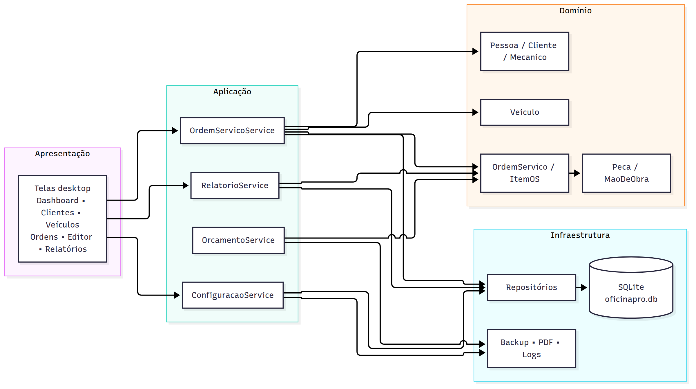
  <figcaption>Figura 1 — Arquitetura preservada: a interface consome os serviços de aplicação, que orquestram domínio e repositórios.</figcaption>
</figure>

## 2.3 Entrada e modos de execução

```text
python3 main.py                 # UI (fallback para CLI se Tkinter/CustomTkinter faltar)
python3 main.py --ui            # força a UI e falha com diagnóstico se indisponível
python3 main.py --cli           # painel CLI
python3 main.py --demo          # modelo em memória (2 clientes, 2 veículos e 2 OS)
```

O fluxo padrão cria/abre o banco, executa a seed quando necessário, fecha a conexão de preparação e abre a janela. Se a importação de `tkinter`/`customtkinter` falhar, o sistema exibe uma mensagem e cai no painel CLI; com `--ui`, o erro é explícito. Essa decisão mantém o projeto demonstrável em ambientes headless e em laboratórios sem dependências gráficas. O caminho do banco pode ser trocado com `--db`.

# 3. Arquitetura da interface

## 3.1 Organização do pacote `ui/`

| Arquivo | Responsabilidade |
|---|---|
| `ui/app.py` | Janela principal, sidebar, navegação, ações globais e notificações |
| `ui/context.py` | Montagem do banco, repositórios e serviços usados pela UI |
| `ui/theme.py` | Paleta, fontes e estilos de status |
| `ui/components.py` | Cards, tabelas, cabeçalhos, badges, indicadores e botões |
| `ui/dialogs.py` | Formulários e diálogo de orçamento/recibo |
| `ui/utils.py` | Formatação, conversão, abertura de arquivos/URLs e helpers |
| `ui/screens/` | Dashboard, clientes, veículos, ordens, editor, relatórios e configurações |

## 3.2 Composição e injeção de dependências

`AppContext` é o ponto único de montagem:

```python
self.db = Database(db_path)
seed_demo(self.db)
self.clientes = ClienteRepository(self.db)
self.veiculos = VeiculoRepository(self.db)
self.mecanicos = MecanicoRepository(self.db)
self.ordens = OrdemServicoRepository(self.db)
self.oficinas = OficinaRepository(self.db)
self.ordem_service = OrdemServicoService(...)
self.orcamento_service = OrcamentoService(...)
self.relatorio_service = RelatorioService(...)
self.configuracao_service = ConfiguracaoService(...)
```

As telas recebem `app` no construtor e acessam `app.context`. Não há singleton global nem criação de repositórios dentro de eventos de botão. O encerramento da janela chama `context.fechar()`, que fecha a conexão SQLite.

## 3.3 Navegação

A sidebar mantém a seção ativa em laranja e reutiliza instâncias de tela. `show_screen(nome, **kwargs)` cria a tela sob demanda, chama `on_show()` e delega filtros contextuais:

- `Clientes → Veículos` abre a frota filtrada pelo cliente;
- `Veículos → Histórico` abre a lista de OS filtrada pelo veículo;
- `Nova OS` abre o editor da OS recém-criada;
- `Voltar` retorna à fila de ordens.

`refresh_screens()` atualiza a tela visível após mutações e deixa as demais para a próxima navegação, sem recriar a janela. Uma falha em uma tela não derruba as demais.

## 3.4 Tema e componentes

O tema reproduz a linguagem visual da Etapa 2: sidebar escura (`#0F172A`), fundo claro (`#F1F5F9`), cartões brancos, bordas suaves e laranja (`#F97316`) como cor de ação. Os status usam badges consistentes:

| Status | Cor |
|---|---|
| Orçamento | âmbar |
| Aprovada | verde |
| Em execução | azul |
| Finalizada | cinza |
| Cancelada | vermelho |

Os componentes reutilizáveis (`Card`, `PageHeader`, `DataTable`, `StatCard`, `Badge`, `SectionHeader`, `SummaryRow`, `ProgressLine`) evitam repetição e mantêm espaçamento, tipografia e estados visuais uniformes.

<figure>
  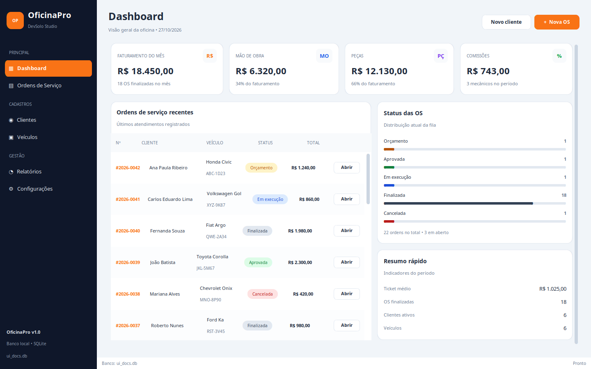
  <figcaption>Figura 2 — Dashboard com indicadores do mês, ordens recentes, distribuição por status e resumo rápido.</figcaption>
</figure>

# 4. Experiência do usuário

## 4.1 Dashboard

O dashboard é a primeira tela após a abertura. Ele responde às perguntas centrais do gestor:

- quanto foi faturado no mês;
- quanto é mão de obra e quanto é peça;
- quanto há de comissões;
- quantas OS estão em cada status;
- quais são as ordens mais recentes.

Os valores são calculados por `RelatorioService` e `OrdemServicoService.resumo_dashboard()`, não pela tela. Os cartões usam `StatCard`; a lista recente usa `DataTable`; o painel de status usa `ProgressLine`.

## 4.2 Cadastros e frota

A tela de **Clientes** oferece busca por nome, telefone, CPF/CNPJ ou e-mail, alternância para mostrar inativos e ações de editar, abrir veículos, inativar ou reativar. O cadastro valida documento e telefone no domínio; a UI apenas coleta e apresenta erros.

A tela de **Veículos** consulta a frota por placa, marca, modelo ou cliente. Cada linha mostra veículo, ano, quilometragem, cliente, status/data da última OS e ações de edição e histórico. O filtro por cliente é contextual: ao chegar de Clientes, a tela exibe apenas os veículos daquele contato e oferece “Limpar filtro”.

## 4.3 Operação

A **fila de ordens** combina busca textual (número, cliente, placa, marca ou modelo) com segmentação por status. O cabeçalho resume OS abertas e orçamentos aguardando aprovação. Cada linha permite abrir a OS, gerar PDF ou abrir o WhatsApp.

O **editor da OS** concentra o ciclo operacional:

- resumo do cliente, veículo, responsável, abertura e total;
- itens de peça e mão de obra com tipo, descrição, quantidade/horas, unitário e subtotal;
- remoção de itens e aplicação de desconto enquanto a OS está em orçamento;
- observações editáveis;
- histórico append-only de status;
- ações de PDF, WhatsApp e documento;
- transições de aprovar, iniciar, finalizar e cancelar.

As ações só aparecem quando permitidas pelo status. A finalização solicita a quilometragem de saída; o cancelamento exige motivo. O histórico é exibido em ordem cronológica e inclui usuário e motivo quando existirem.

<figure class="figure-row">
  <figure>
    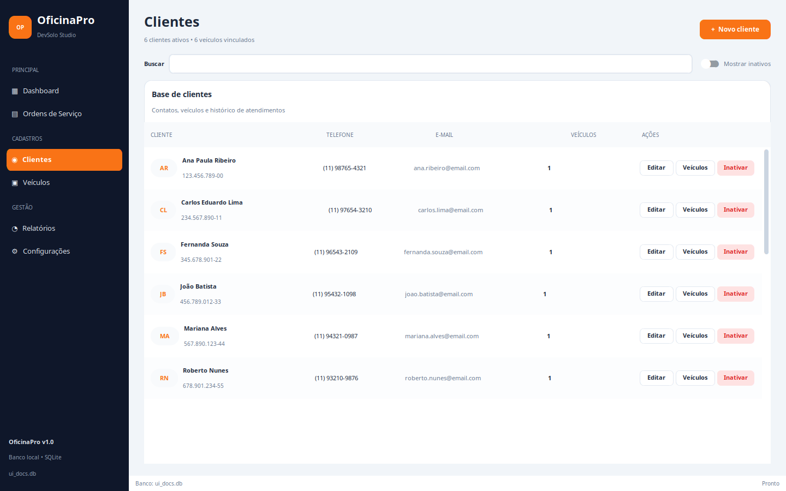
    <figcaption>Figura 3 — Clientes com busca, situação ativa/inativa e acesso direto à frota.</figcaption>
  </figure>
  <figure>
    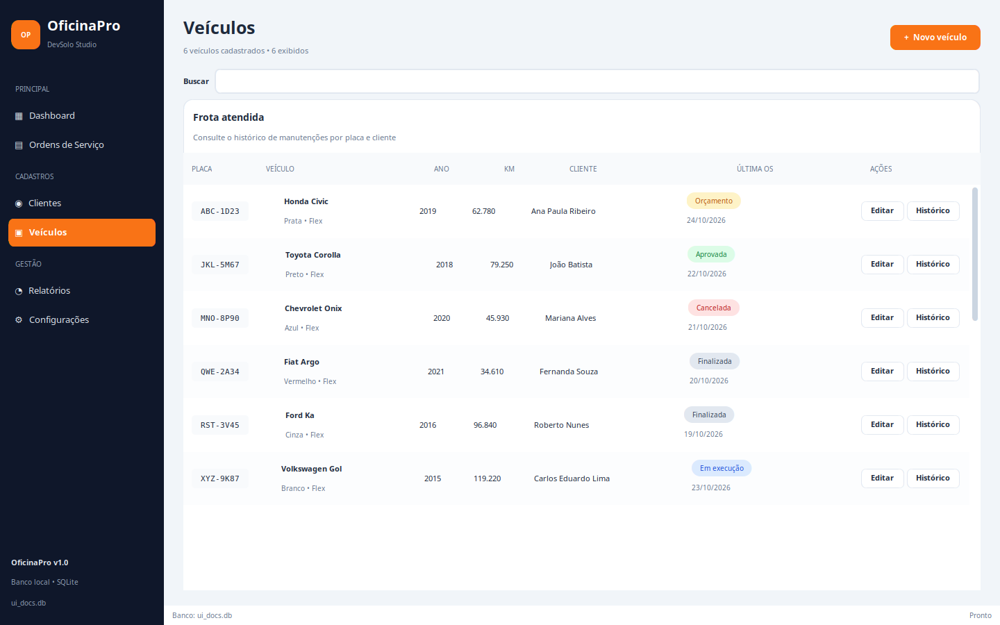
    <figcaption>Figura 4 — Frota atendida, com última OS, quilometragem e acesso ao histórico.</figcaption>
  </figure>
</figure>

<figure class="figure-row">
  <figure>
    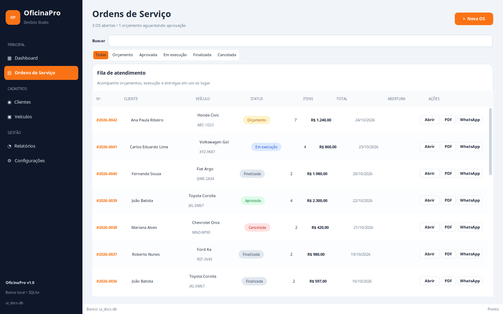
    <figcaption>Figura 5 — Fila de atendimento com busca, filtro por status e ações rápidas.</figcaption>
  </figure>
  <figure>
    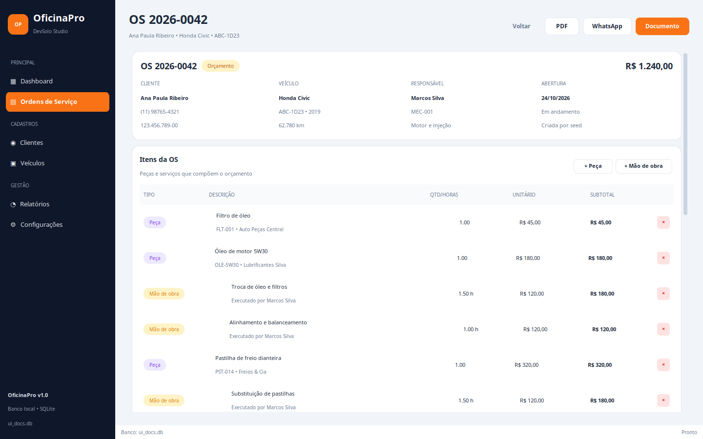
    <figcaption>Figura 6 — Editor da OS 2026-0042 com itens, totais, status e ações contextuais.</figcaption>
  </figure>
</figure>

## 4.4 Relatórios

A tela de relatórios permite escolher o período, voltar ao mês atual e exportar comissões em CSV. Ela apresenta faturamento, mão de obra, peças, comissões, ticket médio, quantidade de OS, comissões por mecânico e composição do faturamento. Os dados vêm de `RelatorioService.resumo_formatado()`; a UI apenas formata e desenha.

<figure class="figure-70">
  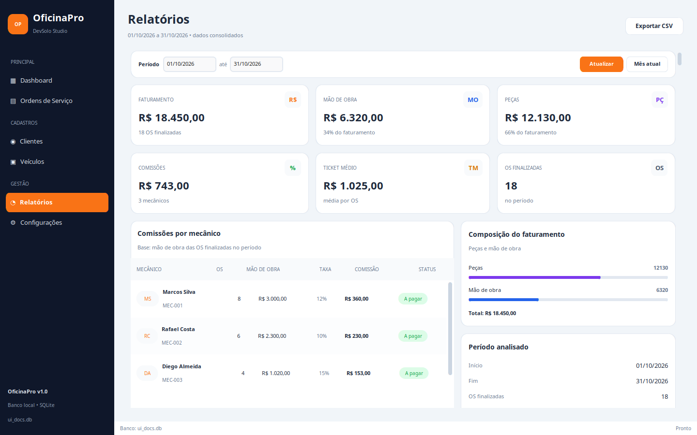
  <figcaption>Figura 7 — Relatórios do período com comissões por mecânico e composição do faturamento.</figcaption>
</figure>

## 4.5 Configurações

A tela é dividida em quatro abas:

| Aba | Conteúdo |
|---|---|
| Oficina | nome, CNPJ, telefone, endereço, taxa horária e comissão padrão |
| Equipe | mecânicos, registro, especialidade, taxa, inativação/reativação |
| Backup | backup imediato, restauração e abertura da pasta |
| Sistema | versão, Python, SQLite, schema, banco e pasta do projeto |

<figure class="figure-row">
  <figure>
    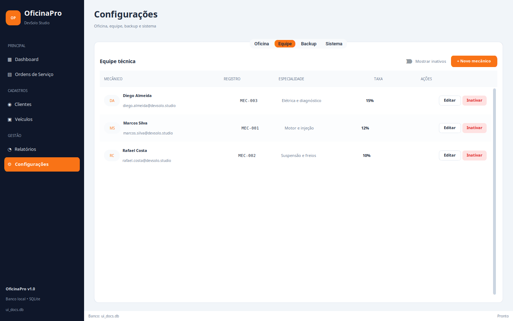
    <figcaption>Figura 8 — Equipe técnica com taxa de comissão e soft delete.</figcaption>
  </figure>
  <figure>
    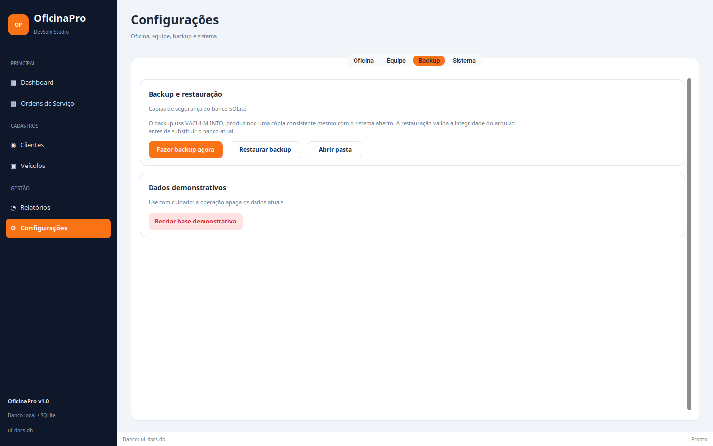
    <figcaption>Figura 9 — Backup e restauração com validação de integridade.</figcaption>
  </figure>
</figure>

# 5. Fluxos principais

## 5.1 Abertura de uma OS

1. O usuário clica em “Nova OS”.
2. O diálogo lista clientes ativos, veículos do cliente e mecânicos ativos.
3. A OS é criada em `ORCAMENTO` por `OrdemServicoService.criar_ordem()`.
4. O editor é aberto com a OS recém-criada.
5. Peças e mão de obra são adicionadas; o total é recalculado pelo domínio.

<figure class="figure-row">
  <figure>
    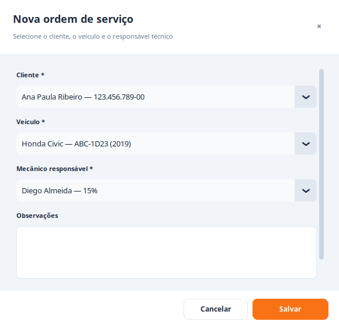
    <figcaption>Figura 10 — Nova OS com seleção de cliente, veículo e responsável.</figcaption>
  </figure>
  <figure>
    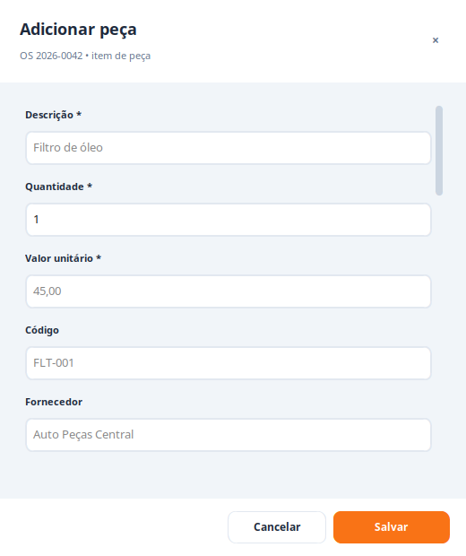
    <figcaption>Figura 11 — Inclusão de peça com quantidade, valor, código e fornecedor.</figcaption>
  </figure>
</figure>

## 5.2 Aprovação, execução e finalização

```text
ORCAMENTO → APROVADA → EM_EXECUCAO → FINALIZADA
     └──────────────┴──────────────┘
              CANCELADA (com motivo)
```

- A aprovação exige ao menos um item e total maior que zero.
- O início só é permitido a partir de `APROVADA`.
- A finalização atualiza a quilometragem do veículo e não permite redução.
- O cancelamento é permitido em orçamento, aprovada ou em execução e exige motivo.
- `FINALIZADA` e `CANCELADA` são terminais.

## 5.3 Orçamento e recibo

O diálogo de documento monta uma prévia com dados da oficina, cliente, veículo, responsável, itens, totais, desconto, observações e histórico. O título muda de “Orçamento” para “Recibo” quando a OS está finalizada. As ações disponíveis são:

- **Copiar mensagem** — texto de WhatsApp;
- **WhatsApp** — link `wa.me`;
- **Abrir PDF** — gera sob demanda e abre o arquivo;
- **Gerar PDF** — grava em `orcamentos/OS-<numero>.pdf`.

<figure class="figure-narrow">
  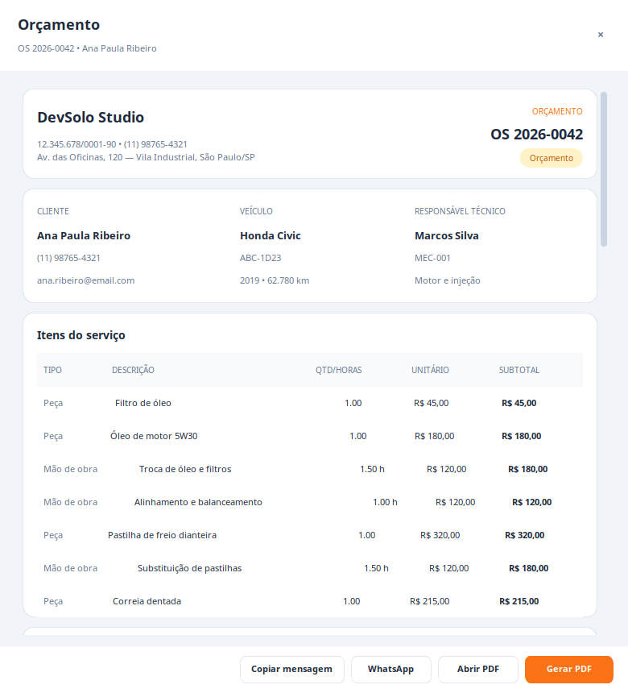
  <figcaption>Figura 12 — Prévia do orçamento com identidade visual, itens e ações de PDF/WhatsApp.</figcaption>
</figure>

# 6. Integração com o núcleo

## 6.1 Regras preservadas

A UI não reimplementa nenhuma regra. Exemplos:

| Ação da UI | Serviço/Repositório |
|---|---|
| Criar OS | `OrdemServicoService.criar_ordem()` |
| Adicionar peça | `OrdemServicoService.adicionar_peca()` |
| Adicionar mão de obra | `OrdemServicoService.adicionar_mao_de_obra()` |
| Aplicar desconto | `OrdemServicoService.aplicar_desconto()` |
| Aprovar/iniciar/finalizar/cancelar | métodos de transição do serviço |
| Gerar PDF/WhatsApp | `OrcamentoService` |
| Relatórios/CSV | `RelatorioService` |
| Backup/restauração | `ConfiguracaoService` |
| Busca/filtros | repositórios especializados |

## 6.2 Persistência e seed

O banco é criado em `infrastructure/migrations.py` com `PRAGMA user_version = 1`. A seed reproduz os totais da Etapa 2 e é carregada automaticamente quando o banco está vazio. As operações da UI usam transações dos repositórios; o histórico de status é append-only.

## 6.3 CLI preservado

O painel CLI continua disponível em `python3 main.py --cli` e é usado como fallback. Ele compartilha os mesmos repositórios e serviços, o que permite demonstrar o sistema mesmo sem interface gráfica.

## 6.4 Conformidade com os requisitos de POO

A tabela abaixo conecta cada exigência da atividade aos elementos implementados. As referências de linha correspondem ao código entregue; os testes ficam em `tests/`.

| Exigência | Onde está | Como foi atendida | Evidência |
|---|---|---|---|
| Pelo menos 5 classes | `domain/` | 10 classes de domínio + 1 enumeração | `Pessoa`, `Cliente`, `Mecanico`, `Veiculo`, `ItemOS`, `Peca`, `MaoDeObra`, `OrdemServico`, `Oficina`, `StatusHistorico`, `StatusOS` |
| Herança | `pessoa.py:10`, `item_os.py:11` | `Pessoa` é superclasse de `Cliente` e `Mecanico`; `ItemOS` é superclasse de `Peca` e `MaoDeObra` | `test_pessoa_abstrata`, `test_itens_polimorficos` |
| Polimorfismo | `item_os.py:48` | `calcular_subtotal()` é abstrato; cada subclasse implementa o cálculo e a OS soma os itens sem testar o tipo concreto | `test_totais_e_desconto` |
| Associação | `veiculo.py` | `Cliente 1 — 0..* Veiculo` bidirecional e sincronizada; a OS referencia cliente, veículo e mecânico | `test_relacionamento_cliente_veiculo` |
| Atributo privado | `ordem_servico.py:92` | `__subtotal` e `__total` com name mangling; acesso somente por propriedades | `test_encapsulamento_do_total` |
| Método privado | `ordem_servico.py:122` | `__recalcular_total`, `__validar_datas`, `__validar_transicao`, `__registrar_historico`; `Pessoa.__validar_contato` | `test_ciclo_completo_e_historico` |
| Programa principal com 2+ objetos | `main.py` | `python3 main.py --demo` instancia 2 clientes, 2 veículos, 1 mecânico e 2 OS, exercitando o ciclo de vida | saída do comando `--demo` |
| Composição | `ordem_servico.py:271` | A OS é dona dos itens; o item só existe no agregado e a remoção passa por `remover_item` | `test_totais_e_desconto` |
| Enumeração | `status_os.py:10` | `StatusOS(str, Enum)` com cinco estados, `from_value`, `rotulo` e `terminal` | `test_ciclo_completo_e_historico` |

A interface reaproveita o mesmo desenho: `BaseScreen` e `FormDialog` são classes base com comportamento comum, e as telas e diálogos concretos apenas especializam o conteúdo.

# 7. Qualidade e validação

## 7.1 Testes automatizados

```bash
python3 -m unittest discover -s tests -v
```

Resultado: **28 testes OK**, cobrindo domínio, validações, transições, persistência, backup/restauração, relatórios, WhatsApp e PDF.

## 7.2 Compilação

```bash
python3 -m compileall -q ui main.py domain application infrastructure
```

Resultado: sem erros.

## 7.3 Validação de execução da interface

A interface foi executada em ambiente com **Python 3.14.4**, **Tk 8.6** e **CustomTkinter 6.0.0** (versão fixada em `requirements-ui.txt`), em janela de 1440 × 900. Foram capturadas as telas e diálogos apresentados neste relatório. Além da inspeção visual, um roteiro de integração exercitou os fluxos reais:

| # | Fluxo validado | Resultado |
|---|---|---|
| 1 | Cadastro de cliente | OK |
| 2 | Cadastro de veículo vinculado | OK |
| 3 | Cadastro de mecânico | OK |
| 4 | Abertura de OS | OK |
| 5 | Inclusão de peça e mão de obra | OK |
| 6 | Desconto e recálculo | OK |
| 7 | Aprovação, início e finalização | OK |
| 8 | Geração de PDF e cópia da mensagem | OK |
| 9 | Abertura do link WhatsApp | OK |
| 10 | Cancelamento com motivo | OK |
| 11 | Inativação/reativação de cliente e mecânico | OK |
| 12 | Exportação CSV | OK |
| 13 | Backup e restauração | OK |
| 14 | PDF/WhatsApp pela janela principal | OK |

O roteiro criou as OS `2026-0043` (finalizada) e `2026-0044` (cancelada) em banco temporário, sem alterar a base demonstrativa do projeto.

## 7.4 Evidências visuais

As capturas em `docs/final/capturas/` foram geradas a partir da aplicação em execução, não de mockups. Elas cobrem dashboard, cadastros, lista e editor de OS, relatórios, abas de configuração e diálogos principais.

# 8. Dados demonstrativos e resultados

A seed mantém os totais da Etapa 2:

| Indicador | Valor |
|---|---:|
| Faturamento | R$ 18.450,00 |
| Mão de obra | R$ 6.320,00 |
| Peças | R$ 12.130,00 |
| Comissões | R$ 743,00 |
| Ticket médio | R$ 1.025,00 |
| OS finalizadas | 18 |
| OS totais | 22 |

| Mecânico | OS | Mão de obra | Taxa | Comissão |
|---|---:|---:|---:|---:|
| Marcos Silva | 8 | R$ 3.000,00 | 12% | R$ 360,00 |
| Rafael Costa | 6 | R$ 2.300,00 | 10% | R$ 230,00 |
| Diego Almeida | 4 | R$ 1.020,00 | 15% | R$ 153,00 |

A base também contém OS em orçamento, aprovada, em execução e cancelada, permitindo demonstrar todos os estados e ações da interface.

# 9. Instalação e execução

```bash
# 1. Ambiente virtual
python3 -m venv .venv
source .venv/bin/activate        # Windows: .venv\Scripts\activate

# 2. Dependência da interface
pip install -r requirements-ui.txt

# 3. Executar
python3 main.py
```

Requisitos:

- Python 3.12+;
- Tkinter disponível na instalação do Python;
- `customtkinter` (instalado por `requirements-ui.txt`);
- Chrome/Chromium para gerar PDFs.

Comandos úteis:

```bash
python3 main.py --cli
python3 main.py --reset
python3 main.py --report
python3 main.py --pdf 2026-0042
python3 main.py --whatsapp 2026-0042
python3 main.py --backup
```

# 10. Limitações e próximos passos

## 10.1 Limitações atuais

- A aplicação é desktop e local; não há autenticação, perfis ou sincronização entre máquinas.
- O controle de pagamento de comissões é apenas informativo (“A pagar”); não há baixa financeira.
- O PDF depende de Chrome/Chromium headless instalado no sistema.
- A interface exige Tkinter/CustomTkinter; em ambiente headless o sistema cai no CLI.
- Não há controle de estoque, agenda de oficina ou emissão fiscal.
- Os testes da UI são de integração manual/automatizada local; não há suíte de testes visuais.

## 10.2 Próximos passos

- Registrar pagamentos de comissões e fechar o ciclo financeiro.
- Adicionar estoque de peças e alertas de mínimo.
- Criar agenda de serviços e previsão de entrega.
- Empacotar com PyInstaller para distribuição.
- Avaliar alternativas de geração de PDF que não dependam de navegador.
- Adicionar autenticação e trilha de auditoria por usuário.
- Ampliar testes automatizados de interface com uma ferramenta dedicada.

# 11. Conclusão

O OficinaPro v1.0 cumpre o contrato construído ao longo do semestre. A Etapa 2 definiu a modelagem e a linguagem visual; a Etapa 3 entregou o núcleo executável; a Etapa Final conectou esse núcleo a uma interface desktop completa, sem duplicar regras e sem alterar o contrato original.

A aplicação permite operar o ciclo completo de uma oficina — do cadastro ao orçamento, da execução ao recibo, do relatório ao backup — com dados demonstrativos consistentes, documentos em PDF, integração com WhatsApp e validação de execução. O resultado é um produto acadêmico coeso, demonstrável e preparado para evoluções futuras.

<div class="closing">
  
  <p><strong>OficinaPro v1.0</strong> • DevSolo Studio</p>
  <p class="muted">Juan Carlos Matos • Entrega final • 19/11/2026</p>
</div>

# 12. Referências

- OFICINAPRO. **Etapa 2 — Modelagem e Interfaces**. DevSolo Studio, 2026. Disponível em `docs/etapa2/`.
- OFICINAPRO. **Etapa 3 — Implementação do Núcleo**. DevSolo Studio, 2026. Disponível em `docs/etapa3/`.
- PYTHON SOFTWARE FOUNDATION. **Python 3.12+ Documentation**. Disponível em <https://docs.python.org/3/>.
- SQLITE. **SQLite Documentation**. Disponível em <https://www.sqlite.org/docs.html>.
- CUSTOMTKINTER. **CustomTkinter Documentation**. Disponível em <https://customtkinter.tomschimansky.com/>.
- GOOGLE. **Chrome Headless Mode**. Disponível em <https://developer.chrome.com/docs/chromium/headless>.
- WHATSAPP. **Click to Chat (wa.me)**. Disponível em <https://faq.whatsapp.com/5913398998672934>.
